<h1 align="center">

</h1>

<h3 align="center">

<a href="https://github.com/Eplankton/mos-stm32/stargazers"></a>
<a href="https://github.com/Eplankton/mos-stm32/network/members"></a>
<a href="https://github.com/Eplankton/mos-stm32/contributors"></a>
<a href="https://github.com/Eplankton/mos-renode/commits"></a>

**[中文](https://gitee.com/Eplankton/mos-renode) | [English](https://github.com/Eplankton/mos-renode)**

</h3>

> [!NOTE]  
> This project is currently under actively developing and improving, some APIs and interfaces may change as the design continues to mature.

## About 🚀

- **MOS** is a Real-Time Operating System (RTOS) project built in C++/Rust, which consists of a preemptive kernel and a command-line shell with other applications (e.g., **GuiLite** and **FatFS**).

- [**Renode**](https://renode.io/) is a virtual development tool created by [**Antmicro**](https://antmicro.com/) for multi-node embedded networks (both wired and wireless) and is intended to enable a scalable workflow for creating effective, tested and secure IoT systems.


## Repository 🌏
- `mos-core` - The Kernel and the Shell, check **[here](https://github.com/Eplankton/mos-core)**.
- `mos-stm32` - Running on STM32 series, check **[here](https://github.com/Eplankton/mos-stm32)**.
- `mos-renode` - Test on Renode emulation, check **[here](https://github.com/Eplankton/mos-renode)**.
- `mos-rust` - A "Vibe Coding" Chimera, check **[here](https://github.com/Eplankton/mos-rust)**.


## Start 📦

- ### Fetch dependencies
  - Run `git submodule update --init --recursive`
  - STM32 dependencies are managed as submodules: `cmsis-core`, `cmsis-device-f4/h7`, `stm32f4xx-hal-driver`, `stm32h7xx-hal-driver`

- ### Use CMake (recommended)
  - Install **CMake** and the `Arm GNU Toolchain`
  - Run `./build.sh` and pick a board
  - Or pass it directly:
    ```bash
    ./build.sh stm32f4-disco
    ./build.sh stm32h7-disco
    ./build.sh all
    ./build.sh clean
    ```
  - Equivalent CMake invocation:
    ```bash
    cmake -S . -B build/stm32f4-disco -DMOS_BOARD=stm32f4-disco
    cmake --build build/stm32f4-disco -j
    ```
  - Artifacts live in `build/<board>`

- ### Renode Emulation
  - Install the **[Renode](https://github.com/renode/renode?tab=readme-ov-file#installation)** platform
  - **Quick demo**: `./emulation/run.sh`, then choose a board and mode (builds and starts automatically)
  - See [emulation/README.md](emulation/README.md) for details
  - **F4**: `renode --console emulation/stm32f4-disco/debug.resc` (Shell on TCP `3333`, GDB on `1234`)
  - **H7**: `renode --console emulation/stm32h7-disco/debug.resc` (USART1 Shell on TCP `3333`, GDB on `1234`)
    - The H7 board starts from HSI (64 MHz). Renode fixes USART1/6 to 200 MHz, so the board code defaults the baud-rate clock to 200 MHz. Override with `-DMOS_H7_UART_CLOCK=<PCLK2>` on real hardware.
  - **Multi-machine M2M**: `emulation/stm32f4-disco/multi_mach.resc` (F4) or `emulation/stm32h7-disco/multi_mach.resc` (H7)
  - In VS Code press `F5` and choose `Cortex Debug (F4)` or `Cortex Debug (H7)`

- ### Use EIDE (legacy F4 workflow)
  - The EIDE project is still present under `.eide/`, but multi-board builds use CMake. Reconfigure EIDE against the new `examples/` and `vendor/stm32/` layout if needed.


## Manual 📚

- **[用户手册(中文)](manual_zh.pdf) | [Manual(English) from **DeepWiki**](https://deepwiki.com/Eplankton/mos-renode)**

## Architecture 🔍

```
.
├── 📁 emulation             // Renode emulation scripts
├── 📁 examples              // Examples and board support
│   ├── common/              // UART driver, platform headers, shared tests
│   └── boards/
│       ├── stm32f4-disco/   // main.cpp / board.hpp / HAL conf / linker
│       └── stm32h7-disco/
├── 📁 vendor/stm32          // CMSIS + HAL/LL dependencies
├── 📁 core
│   ├── 📁 external          // External Library
│   ├── 📁 arch              // Architecture-Specific Code
│   │   ├── cpu.hpp          // Architecture header entry
│   │   └── cortex_m.hpp     // Context Switching
│   │
│   ├── 📁 kernel            // Kernel Layer
│   │   ├── macro.hpp        // Kernel Constants Macro
│   │   ├── type.hpp         // Basic Types
│   │   ├── concepts.hpp     // Type Constraints
│   │   ├── data_type.hpp    // Basic Data Structures
│   │   ├── alloc.hpp        // Memory Management
│   │   ├── global.hpp       // Kernel global variable declarations
│   │   ├── global.cpp       // Kernel global variable definitions
│   │   ├── printf.h/.c      // Thread-Safe printf
│   │   ├── task.hpp         // Task Management
│   │   ├── sync.hpp         // Synchronization Primitives
│   │   ├── async.hpp        // Asynchronous Stackless Coroutines
│   │   ├── scheduler.hpp    // Scheduler
│   │   ├── ipc.hpp          // Inter-Process Communication
│   │   └── utils.hpp        // Other Utilities
│   │
│   ├── config.h             // System Configuration
│   ├── kernel.hpp           // Kernel Modules
│   └── shell.hpp            // Shell Command Line
```

## Example 🍎

Each board has one standalone program under `examples/`; see [examples/README.md](examples/README.md):

| Example | Description |
|---|---|
| `boards/stm32f4-disco/main.cpp` | F4: shell + LED + M2M + kernel tests |
| `boards/stm32h7-disco/main.cpp` | H7: shell + LED + M2M + kernel tests |

```bash
./build.sh stm32f4-disco
./build.sh stm32h7-disco
```

`Shell Test`
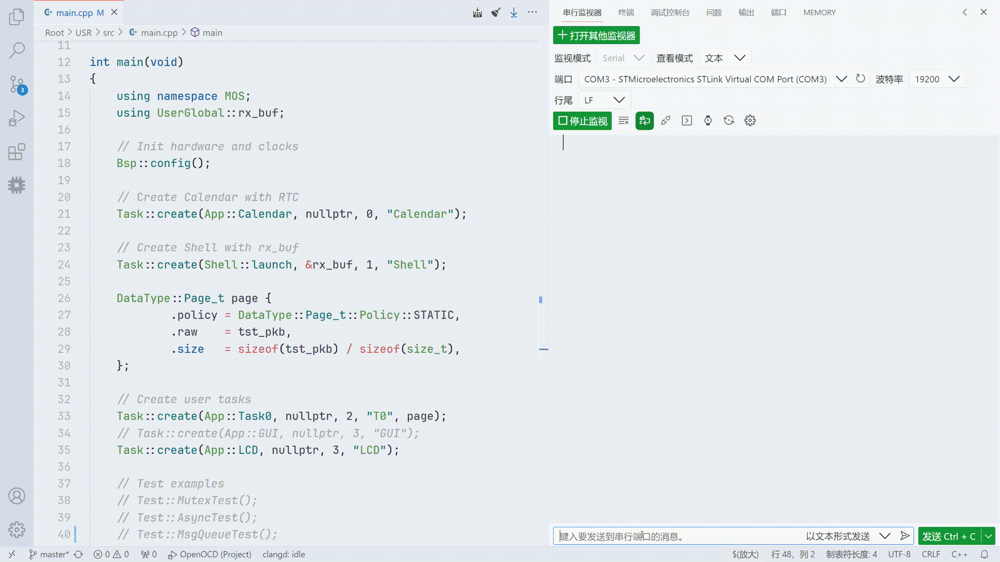

`Mutex Test(Priority Ceiling Protocol)`
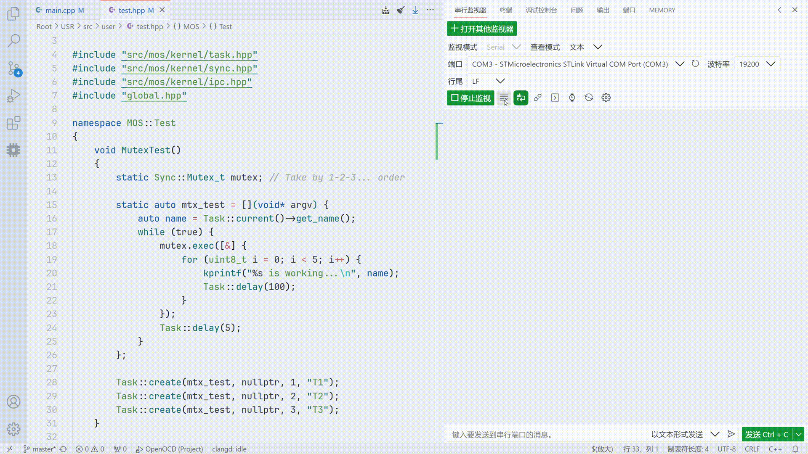

`LCD Driver & GUI Demo`<br>
<p align="center">
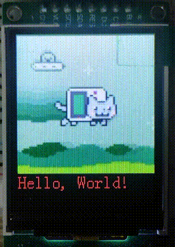 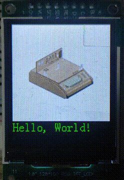 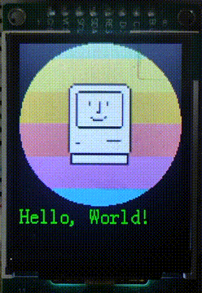
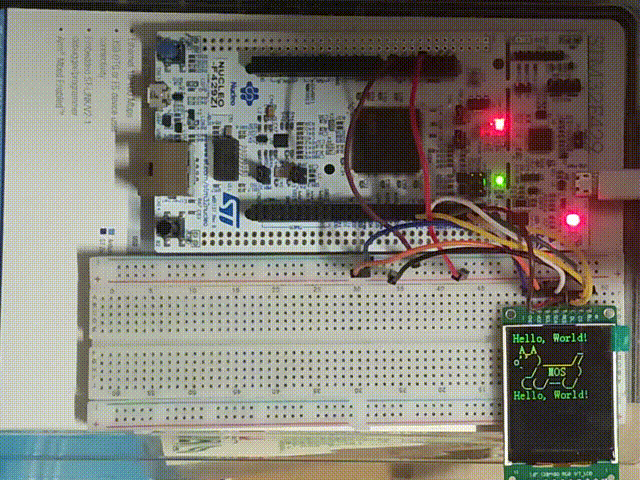 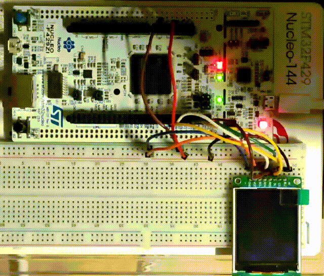
</p>

`Concurrent Task Period & Time Sequence`<br>
<p align="center">
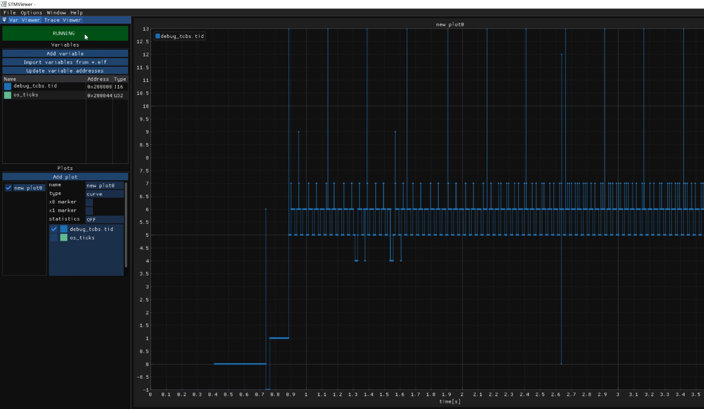
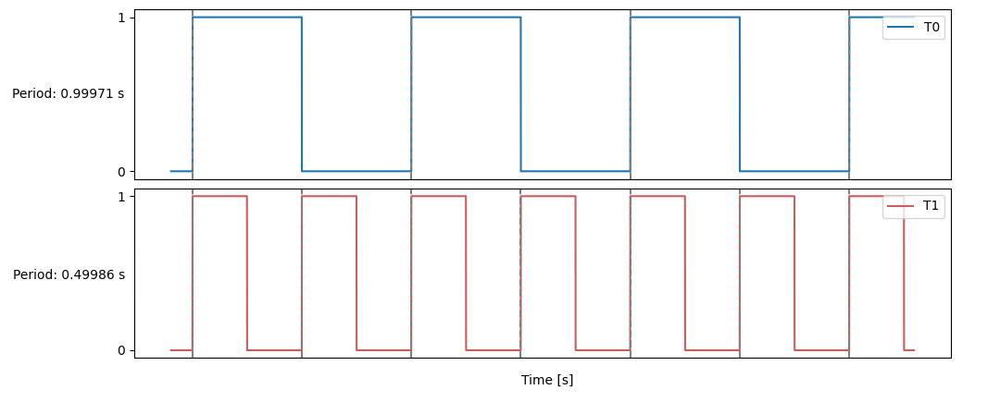
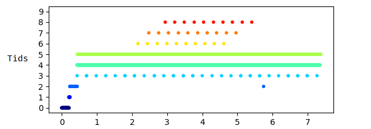
</p>

```cpp
// Entry point: examples/boards/stm32f4-disco/main.cpp
#include "board.hpp"
#include "kernel.hpp"
#include "shell.hpp"
#include "common/tests.hpp"

using namespace MOS;
namespace Board = Boards::STM32F4Disco;

static void led_task()
{
	while (true) {
		Board::led_toggle();
		Kernel::Task::delay(500_ms);
	}
}

static void m2m_task()
{
	char msg[]           = "Hej! I'm Mx";
	msg[sizeof(msg) - 2] = Board::machine_id();

	[&] -> Kernel::Async::Future_t<> {
		while (true) {
			Board::hub().send_line(msg);
			co_await Kernel::Async::delay(500_ms);
		}
	}();

	while (true) {
		LOG("rx -> \"%s\"", Board::hub().buf.recv().as_str());
	}
}

int main()
{
	Board::init(); // clocks, GPIO, USART, SysTick

	Kernel::Task::create(Shell::launch<Board::Stdio::max_size()>, &Board::stdio().buf, 0, "shell");
	Kernel::Task::create(led_task, nullptr, 1, "led");
	Kernel::Task::create(m2m_task, nullptr, 2, "m2m");

	/* Test examples */
	Kernel::Task::create(Examples::Test::MsgQueueTest<3>, nullptr, 2, "msgq/test");
	Kernel::Task::create(Examples::Test::AsyncTest<300>, nullptr, 2, "async/test");

	Kernel::Scheduler::launch(); // never returns
}
```

The board support lives in `examples/boards/<board>/board.hpp` and is header-only:

```cpp
namespace MOS::Boards::STM32F4Disco
{
	using Stdio = Common::SyncUart<MOS_CONF_SHELL_BUF_SIZE>;
	using Hub   = Common::SyncUart<32>;

	void init();
	Stdio& stdio();
	Hub& hub();
	void led_toggle();
	char machine_id();
}
```

## Boot Up ⚡
```plain
 A_A       _   [name]  @ x.x.x(Version)
o'' )_____//   Build   @ TIME, DATE
 `_/  MOS  )   Chip    @ MCU, ARCH
 (_(_/--(_/    2023-2026 Copyright by Eplankton

<Tid> <Name> <Priority> <Status> <Mem%>
---------------------------------------
 #0   shell        0     RUNNING     7%
 #1   led          1     READY       7%
 #2   m2m          2     READY       7%
 #3   msgq/test    2     READY       7%
 #4   async/test   2     READY       7%
 #5   idle         127   READY      15%
---------------------------------------
```

## Scheduling Policies 🧭

The kernel picks one scheduling policy at compile time (`Kernel::Policy`). All policies share the same context-switch path and add no runtime overhead:

| Policy | Ready-queue key | Preemptive | Notes |
|---|---|---|---|
| `RoundRobin` | arrival order | time slice | priority ignored, FIFO rotation |
| `PreemptPri` | static priority | yes | time-slice rotation within a priority (default) |
| `RateMonotonic` (RM) | period `T` | yes | shorter period wins; optimal for fixed priority when `D = T` |
| `DeadlineMonotonic` (DM) | relative deadline `D` | yes | generalizes RM to `D <= T` |
| `EarliestDeadlineFirst` (EDF) | absolute deadline | yes | optimal for preemptive uniprocessor, schedulable when `ΣC/T <= 1` |
| `Cooperative` (Coop) | static priority | no | switches only on block or explicit `Task::yield()` |

Select it in `core/config.h`:

```c
#define MOS_CONF_SCHED_POLICY EarliestDeadlineFirst
```

or override it from CMake without touching the source:

```bash
cmake -S . -B build/stm32f4-disco -DMOS_SCHED_POLICY=EarliestDeadlineFirst
```

The default remains `PreemptPri`, so existing projects keep their behaviour.

### Periodic tasks

```cpp
static void control_job()
{
	while (true) {
		/* work */
		Kernel::Task::periodic_wait(); // block until the next activation
	}
}

Kernel::Task::create_periodic(
    control_job, nullptr,
    0,      // base priority (RM/DM override it from T/D)
    20_ms,  // period T
    20_ms,  // relative deadline D (0 means D = T)
    "ctrl",
    3_ms    // optional WCET for admission control
);
```

- The first job starts immediately; every `periodic_wait()` wake-up refreshes the absolute deadline as `dl_abs = activation + D`.
- With a WCET, admission control runs: Liu & Layland bound for RM, density test for DM, `ΣC/T <= 1` for EDF. A rejected task makes `create_periodic` return `nullptr`.
- Each missed deadline is counted once per job; query it with `Task::missed_deadlines()`. See `examples/common/sched_test.hpp` for a demo.

### Behavioral tests

`SchedPolicyTest()` in `examples/common/tests.hpp` runs automatically in the default build. Batteries are selected at compile time for the active policy and each prints one `[TEST] ... PASS/FAIL` line:

| Case | Policies | Checks |
|---|---|---|
| RR fairness | all | equal-priority (equal-deadline) tasks rotate fairly, share spread < 40% |
| Preemption | PreemptPri/RM/DM | a higher-priority task preempts a busy lower-priority one |
| Cooperative | Cooperative | the busy task keeps the CPU until it finishes; higher priority waits |
| Deadline order | RM/DM/EDF | jobs run in T/D/absolute-deadline order (created in reverse); RM/DM also verify derived priorities |
| Periodic timing | PreemptPri/RM/DM/EDF | activation interval stays near the period; no missed deadline under EDF |
| Nested PIP | PreemptPri/RM/DM | nested-mutex priority boosts unwind level by level; no medium-priority inversion |

### Notes

- RM/DM map periods/deadlines onto priorities `[0, 31]` via `floor(log2(T))`; use `>= 32` for ordinary tasks.
- Under EDF, tasks without a deadline (`Task::create`) rank after periodic ones and rotate by time slice, so they never starve.
- `Cooperative` has no tick preemption: CPU-bound work must call `Task::yield()` explicitly.
- Priority inheritance (PIP) supports nested locks; depth is set by `MOS_CONF_PRI_STACK_DEPTH`.
- Build the policy demo with `-DMOS_SCHED_DEMO=ON` (or `MOS_SCHED_DEMO=ON ./build.sh <board>`). That build skips the `msgq/test` and `async/test` stress tests so they do not exhaust the page pool or flood the UART log.

## Milestone 🧾


📦 `v0.5`

> ✅ Done：
> - Added `RateMonotonic` / `DeadlineMonotonic` / `EarliestDeadlineFirst` / `Cooperative` policies and completed `RoundRobin`
> - Added the periodic-task API `Task::create_periodic` / `Task::periodic_wait` with admission control
> - Fixed the PendSV-over-SysTick stall, nested priority inheritance and tick-wrap comparisons
> - **[Experimental]** Port to `ESP32-C6(RISC-V)`
> - **[Experimental]** Rewrite it in Rust


📦 `v0.4`

> ✅ Done：
>
> - Add Hardware `FPU` support
> - **CMake Tools** are now available for compiling the project
> - Add external library [**ETL**](https://www.etlcpp.com/), a C++ template library for embedded applications
> - Add `Renode` emulation platform, add stable support for `Cortex-M` series
> - **[Experimental]** Add scheduler lock `Scheduler::suspend()`
> - **[Experimental]** Add Asynchronous stackless coroutines `Async::{Executor, Future_t, co_await/yield/return}`
>
> 📌 Planned: 
>
> - Shift from `FatFS` to `LittleFS`

📦 `v0.3`

> ✅ Done:
>
> - Mapping `Tids` to `BitMap_t`
> - Message queue `IPC::MsgQueue_t`
> - `Task::create` allows generic function signatures as `void fn(auto argv)` with type checker
> - Add `ESP32-C3` as a `WiFi` component
> - Add `Driver::Device::SD_t`, `SD` card driver, porting `FatFs` file system
> - Add `Shell::usr_cmds` for user-registered commands
> - **[Experimental]** Atomic types `<stdatomic.h>`
> - **[Experimental]** `Utils::IrqGuard_t`, nested interrupt critical sections
> - **[Experimental]** Simple formal verification of `Scheduler + Mutex`
>
> 📌 Planned: 
>
> - Inter-Process Communication: pipes/channels
> - `FPU` hardware float support
> - Performance benchmarking
> - Error handling with `Result<T, E>`, `Option<T>`
> - `DMA_t` DMA Driver
> - Software/hardware timers `Timer`
> - **[Experimental]** Adding `POSIX` support
> - **[Experimental]** More real-time scheduling algorithms


📦 `v0.2`

> ✅ Done:
> 
> - Synchronization primitives `Sync::{Sema_t, Lock_t, Mutex_t<T>, CondVar_t, Barrier_t}`
> - `Scheduler::Policy::PreemptPri` with `RoundRobin` scheduling for same priority levels
> - `Task::terminate` implicitly called upon task exit to reclaim resources
> - Simple command-line interaction `Shell::{Command, CmdCall, launch}`
> - `HAL::STM32F4xx::SPI_t` and `Driver::Device::ST7735S_t`, porting the `GuiLite` graphics library
> - Blocking delay with `Kernel::Global::os_ticks` and `Task::delay`
> - Refactored project organization into `{kernel, arch, drivers}`
> - Support for `GCC` compilation, compatible with `STM32Cube HAL`
> - Real-time calendar `HAL::STM32F4xx::RTC_t`, `CmdCall::date_cmd`, `App::Calendar`
> - `idle` uses `Kernel::Global::zombie_list` to reclaim inactive pages
> - Three basic page allocation policies `Page_t::Policy::{POOL, DYNAMIC, STATIC}`


📦 `v0.1`

> ✅ Done:
> 
> - Basic data structures, scheduler, and task control, memory management
>
> 📌 Planned: 
> 
> - Timers, round-robin scheduling
> - Inter-Process Communication (IPC), pipes, message queues
> - Process synchronization (Sync), semaphores, mutexes
> - Design a simple Shell
> - Variable page sizes, memory allocator
> - SPI driver, porting GuiLite/LVGL graphics libraries
> - Porting to other boards/arch, e.g., ESP32-C3 (RISC-V)


## References 🛸
- [How to build a Real-Time Operating System(RTOS)](https://medium.com/@dheeptuck/building-a-real-time-operating-system-rtos-ground-up-a70640c64e93)
- [PeriodicScheduler_Semaphore](https://github.com/Dungyichao/PeriodicScheduler_Semaphore)
- [STM32F4-LCD_ST7735s](https://github.com/Dungyichao/STM32F4-LCD_ST7735s)
- [A printf/sprintf Implementation for Embedded Systems](https://github.com/mpaland/printf)
- [GuiLite](https://github.com/idea4good/GuiLite)
- [STMViewer](https://github.com/klonyyy/STMViewer)
- [FatFs](http://elm-chan.org/fsw/ff)
- [The Zephyr Project](https://www.zephyrproject.org/)
- [Eclipse ThreadX](https://github.com/eclipse-threadx/threadx)
- [Embassy](https://embassy.dev/)
- [Renode](https://renode.io/)
- [Embedded Template Library (ETL)](https://www.etlcpp.com)
---

<p align="center">
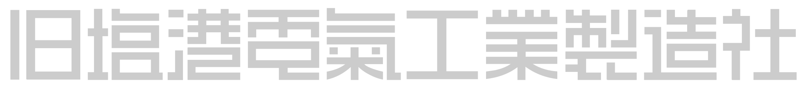

</p>

```plain
I hope the Pacific is as blue as it has been in my dreams. 
I hope.

-- Stephen King's "Rita Hayworth and the Shawshank Redemption", 1982
```