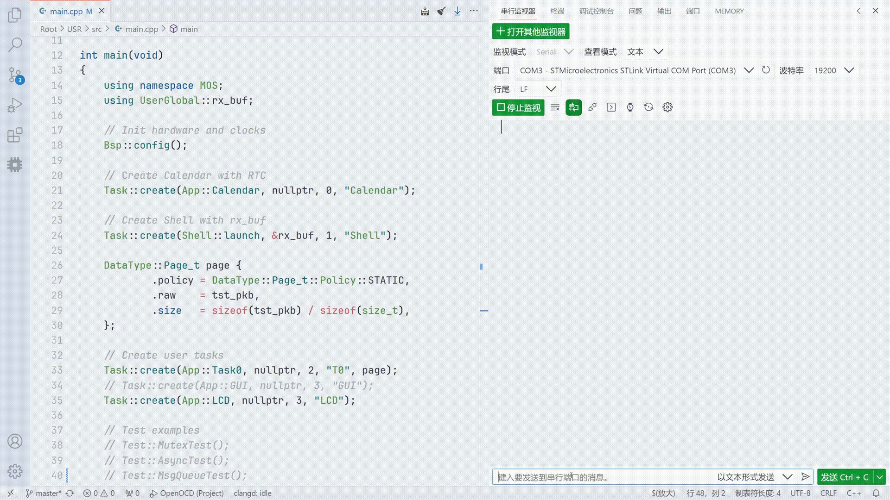
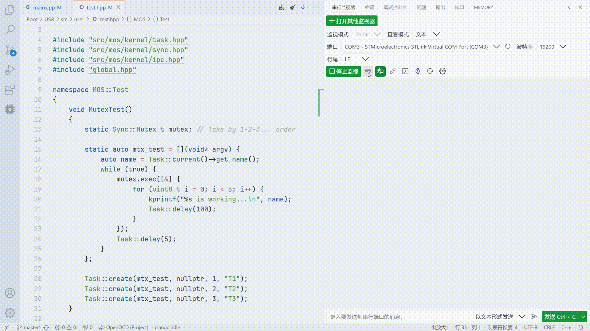
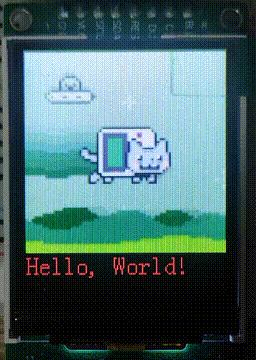
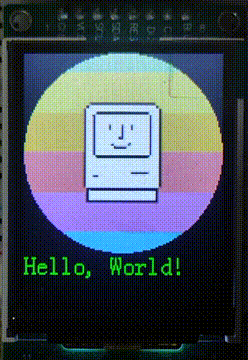
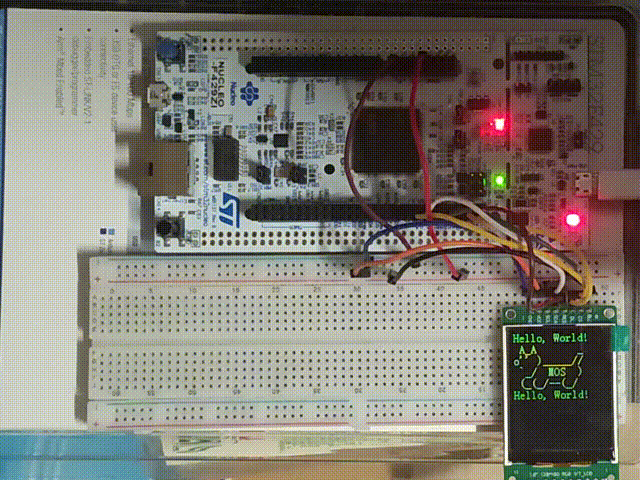
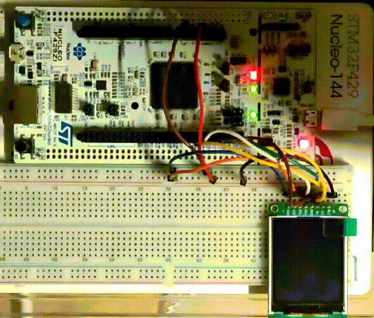
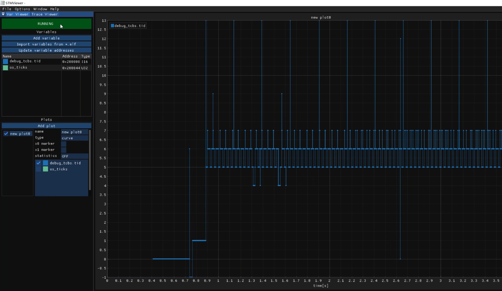
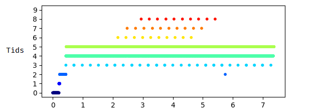
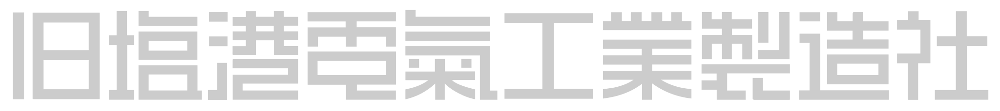

<h1 align="center">

</h1>

<h3 align="center">

<a href="https://github.com/Eplankton/mos-stm32/stargazers"></a>
<a href="https://github.com/Eplankton/mos-stm32/network/members"></a>
<a href="https://github.com/Eplankton/mos-stm32/contributors"></a>
<a href="https://github.com/Eplankton/mos-renode/commits"></a>

**[中文](https://gitee.com/Eplankton/mos-renode) | [English](https://github.com/Eplankton/mos-renode)**

</h3>

> [!NOTE]  
> This project is currently under actively developing and improving, some APIs and interfaces may change as the design continues to mature.

## About 🚀

- **MOS** is a Real-Time Operating System (RTOS) project built in C++/Rust, which consists of a preemptive kernel and a command-line shell with other applications (e.g., **GuiLite** and **FatFS**).

- [**Renode**](https://renode.io/) is a virtual development tool created by [**Antmicro**](https://antmicro.com/) for multi-node embedded networks (both wired and wireless) and is intended to enable a scalable workflow for creating effective, tested and secure IoT systems.

## Repository 🌏

- `mos-core` - The kernel and the shell, check **[here](https://github.com/Eplankton/mos-core)**.
- `mos-stm32` - Running on STM32 series, check **[here](https://github.com/Eplankton/mos-stm32)**.
- `mos-renode` - Test on Renode emulation, check **[here](https://github.com/Eplankton/mos-renode)**.
- `mos-rust` - A "Vibe Coding" Chimera, check **[here](https://github.com/Eplankton/mos-rust)**.

## Getting Started 📦

### Prerequisites

- **CMake**, the **[Arm GNU Toolchain](https://developer.arm.com/downloads/-/arm-gnu-toolchain-downloads)** and **[Renode](https://github.com/renode/renode?tab=readme-ov-file#installation)**
- For HiFive1, the **[xPack RISC-V GCC](https://github.com/xpack-dev-tools/riscv-none-elf-gcc-xpack/releases)**: unpack it under `~/.local/xpacks/` to be found automatically (or pass `-DMOS_RISCV_TOOLCHAIN_DIR=<dir>/bin`)
- Submodules: `git submodule update --init --recursive` (CMake also initializes the ones it needs). The benchmark submodules (Thread-Metric, RTOS-Benchmark, FreeRTOS-Kernel) are skipped and fetched the first time a benchmark runs

### Build

```bash
./build.sh                  # board menu
./build.sh stm32f4-disco    # or stm32h7-disco / hifive1 / all / clean
```

Artifacts go to `build/<board>/`. `build.sh` wraps CMake:

```bash
cmake -S . -B build/stm32f4-disco -DMOS_BOARD=stm32f4-disco
cmake --build build/stm32f4-disco -j
```

### Emulate

```bash
./emulation/run.sh                       # pick a board and a mode, builds and starts Renode
./emulation/run.sh stm32f4-disco demo    # or name them directly
./emulation/selftest.sh                  # self-test: 3 boards x 6 policies
```

The board scripts can also be opened in Renode directly:

| Board | Single machine | Two machines (M2M) |
|---|---|---|
| F4 | `examples/boards/stm32f4-disco/renode/debug.resc` | `.../multi_mach.resc` |
| H7 | `examples/boards/stm32h7-disco/renode/debug.resc` | `.../multi_mach.resc` |
| HiFive1 | `examples/boards/hifive1/renode/debug.resc` | `.../multi_mach.resc` |

The single-machine scripts put the shell on TCP `3333` and GDB on `1234`. In VS Code, press `F5` and choose `Cortex Debug (F4)`, `Cortex Debug (H7)` or `RISC-V Debug (HiFive1)`. Modes, ports and per-board model notes: [emulation/README.md](emulation/README.md).

### EIDE

Open the repository root with the [EIDE](https://github.com/github0null/eide) VS Code extension to build and flash the F4 example (Debug / Release targets). Its sources mirror `examples/boards/stm32f4-disco/board.cmake`; keep `.eide/eide.yml` in sync when `BOARD_SOURCES` changes. Multi-board builds, self-tests and benchmarks use CMake.

## Performance 📊

MOS against **FreeRTOS V11.3.3** on the same Renode machine (Cortex-M4F core executing 100 MIPS, 16 MHz SysTick clock, 1 kHz OS tick, 100 ns timer resolution), with the same compiler flags, timing code and test sources. Speedup is MOS over FreeRTOS: above 1 means MOS performs better.

**Thread-Metric**: throughput, operations per second, higher is better

| Test | MOS | FreeRTOS | Speedup |
|---|---:|---:|---:|
| Cooperative scheduling | 1,255,357 | 1,513,615 | 0.83 |
| Preemptive scheduling | 527,038 | 380,932 | 1.38 ✅|
| Interrupt processing | 1,784,401 | 1,218,988 | 1.46 ✅|
| Interrupt preemption | 406,205 | 301,985 | 1.35 ✅|
| Message processing | 876,547 | 707,410 | 1.24 ✅|
| Synchronization (semaphore) | 2,039,315 | 1,218,996 | 1.67 ✅|

**RTOS-Benchmark**: latency of one operation, ns, lower is better

| Operation | MOS | FreeRTOS | Speedup |
|---|---:|---:|---:|
| Semaphore take (context switch) | 900 | 4,100 | 4.56 ✅|
| Semaphore give (context switch) | 1,400 | 2,300 | 1.64 ✅|
| Mutex lock (no owner) | 300 | 800 | 2.67 ✅|
| Mutex pend (priority inheritance) | 1,900 | 5,100 | 2.68 ✅|
| Mutex unlock to a waiter (context switch) | 3,000 | 3,200 | 1.07 ✅|
| Mutex unlock to a waiter (no context switch) | 1,900 | 1,000 | 0.53 |
| Message queue send (context switch) | 2,500 | 2,900 | 1.16 ✅|
| Message queue receive (context switch) | 2,400 | 2,900 | 1.21 ✅|
| Yield (context switch) | 800 | 700 | 0.88 |

- MOS is faster at blocking and waking: semaphores, mutexes, message queues, and the related throughput tests (1.2–1.7x).
- FreeRTOS is faster at plain task switching: yield is about 1.1x and cooperative scheduling about 1.2x quicker.
- Renode is not cycle-accurate. The numbers compare the length of the two kernels' code paths, not timing on real hardware.
- Reproduce: `./benchmarks/compare.sh` (about 2 minutes). Full results, setup and what is not comparable: [benchmarks/README.md](benchmarks/README.md).

## Manual 📚

- **[用户手册(中文)](manual_zh.pdf) | [Manual(English) from **DeepWiki**](https://deepwiki.com/Eplankton/mos-renode)**

## Layout 🔍



### Repository

```text
.
├── core/            // kernel (submodule), see below
├── examples/
│   ├── common/      // tests and demos shared by the boards
│   └── boards/      // one directory per board
├── emulation/       // Renode launcher and self-test
├── benchmarks/      // benchmarks and the FreeRTOS comparison
├── vendor/
│   ├── stm32/       // CMSIS, HAL/LL (submodules)
│   └── sifive/      // registers generated from the SVD
├── build.sh         // build entry point
└── CMakeLists.txt
```

Each directory has its own README: [examples](examples/README.md) (board directory contract, adding a board), [emulation](emulation/README.md), [benchmarks](benchmarks/README.md), [vendor/sifive](vendor/sifive/README.md).

### Kernel

```text
core/
├── kernel.hpp          // kernel umbrella header
├── shell.hpp           // command line
├── config.h            // configuration
├── CMakeLists.txt      // mos::core library
│
├── arch/               // architecture ports
│   ├── cpu.hpp         // port contract, compile-time check
│   ├── cpu_isr.hpp     // exception entry dispatch
│   ├── cortex_m/       // Cortex-M4/M7
│   └── riscv32/        // RV32 machine mode
│
├── kernel/
│   ├── macro.hpp       // constants
│   ├── type.hpp        // basic types
│   ├── concepts.hpp    // type constraints
│   ├── data_type/      // list, bitmap, TCB, page
│   ├── alloc.hpp       // page allocator
│   ├── global.hpp/.cpp // global state
│   ├── task.hpp        // tasks
│   ├── policy.hpp      // scheduling policies
│   ├── scheduler.hpp   // scheduler
│   ├── sync.hpp        // semaphore, mutex, condition variable
│   ├── ipc.hpp         // message queue
│   ├── async.hpp       // stackless coroutines
│   └── utils.hpp       // critical sections, logging
│
├── libc/               // printf, newlib stubs
└── external/etl/       // ETL (submodule)
```

## Example 🍎

Each board has one standalone program, `examples/boards/<board>/main.cpp`:

| Board | Contents |
|---|---|
| F4, H7 | shell, LED, two-machine M2M, kernel tests |
| HiFive1 | shell, LED, two-machine M2M, scheduling-policy tests (no message-queue or coroutine stress tests) |

```cpp
// examples/boards/stm32f4-disco/main.cpp
#include "board.hpp"
#include "kernel.hpp"
#include "shell.hpp"
#include "common/kernel_tests.hpp"

using namespace MOS;
namespace Board = Boards::STM32F4Disco;

static void led_task()
{
	while (true) {
		Board::led_toggle();
		Kernel::Task::delay(500_ms);
	}
}

// A named coroutine copies its parameters into the frame; a capturing lambda
// coroutine only keeps a reference to its (temporary) closure.
static Kernel::Async::Future_t<> m2m_tx(const char* msg)
{
	while (true) {
		Board::hub().send_line(msg);
		co_await Kernel::Async::delay(500_ms);
	}
}

static void m2m_task()
{
	char msg[]           = "Hej! I'm Mx";
	msg[sizeof(msg) - 2] = Board::machine_id();

	m2m_tx(msg);

	while (true) {
		LOG("rx -> \"%s\"", Board::hub().buf.recv().as_str());
	}
}

int main()
{
	Board::init(); // clocks, GPIO, USART, SysTick

	Kernel::Task::create(Shell::launch<Board::Stdio::max_size()>, &Board::stdio().buf, 0, "shell");
	Kernel::Task::create(led_task, 1, "led");
	Kernel::Task::create(m2m_task, 2, "m2m");

	/* Test examples */
	Kernel::Task::create(Test::MsgQueueTest<3>, 2, "msgq/test");
	Kernel::Task::create(Test::AsyncTest<300>, 2, "async/test");

	Kernel::Scheduler::launch(); // never returns
}
```

The board support in `examples/boards/<board>/board.hpp` (header-only) gives every example the same interface:

```cpp
namespace MOS::Boards::STM32F4Disco
{
	using Stdio = Drivers::SyncUart<Drivers::Stm32Usart, MOS_CONF_SHELL_BUF_SIZE>;
	using Hub   = Drivers::SyncUart<Drivers::Stm32Usart, 32>;

	void init();
	Stdio& stdio();
	Hub& hub();
	void led_toggle();
	char machine_id();
}
```

Boot output:

```plain
 A_A       _   [name]  @ x.x.x(Version)
o'' )_____//   Build   @ TIME, DATE
 `_/  MOS  )   Chip    @ MCU, ARCH
 (_(_/--(_/    2023-2026 Copyright by Eplankton

<Tid> <Name> <Priority> <Status> <Mem%>
---------------------------------------
 #0   shell        0     RUNNING     7%
 #1   led          1     READY       7%
 #2   m2m          2     READY       7%
 #3   msgq/test    2     READY       7%
 #4   async/test   2     READY       7%
 #5   idle         127   READY      15%
---------------------------------------
```

- `Shell Test`


- `Mutex Test(Priority Inheritance Protocol)`


- `LCD Driver & GUI Demo`<br>
<p align="center">
  
 
</p>

- `Concurrent Task Period & Time Sequence`<br>
<p align="center">



</p>

## Scheduling Policies 🧭

The kernel picks one scheduling policy at compile time (`Kernel::Policy`). All policies share the same context-switch path and add no runtime overhead:

| Policy | Ready-queue key | Preemptive | Notes |
|---|---|---|---|
| `RoundRobin` | arrival order | time slice | priority ignored, FIFO rotation |
| `PreemptPri` | static priority | yes | time-slice rotation within a priority (default) |
| `RateMonotonic` (RM) | period `T` | yes | shorter period wins; optimal for fixed priority when `D = T` |
| `DeadlineMonotonic` (DM) | relative deadline `D` | yes | generalizes RM to `D <= T` |
| `EarliestDeadlineFirst` (EDF) | absolute deadline | yes | optimal for preemptive uniprocessor, schedulable when `ΣC/T <= 1` |
| `Cooperative` (Coop) | static priority | no | switches only on block or explicit `Task::yield()` |

Select it in `core/config.h`:

```c
#define MOS_CONF_SCHED_POLICY EarliestDeadlineFirst
```

or override it from CMake without touching the source:

```bash
cmake -S . -B build/stm32f4-disco -DMOS_SCHED_POLICY=EarliestDeadlineFirst
```

The default remains `PreemptPri`, so existing projects keep their behaviour.

### Periodic tasks

```cpp
static void control_job()
{
	while (true) {
		/* work */
		Kernel::Task::periodic_wait(); // block until the next activation
	}
}

Kernel::Task::create_periodic(
    control_job, nullptr,
    0,      // base priority (RM/DM override it from T/D)
    20_ms,  // period T
    20_ms,  // relative deadline D (0 means D = T)
    "ctrl",
    3_ms    // optional WCET for admission control
);
```

- The first job starts immediately; every `periodic_wait()` wake-up refreshes the absolute deadline as `dl_abs = activation + D`.
- With a WCET, admission control runs: Liu & Layland bound for RM, density test for DM, `ΣC/T <= 1` for EDF. A rejected task makes `create_periodic` return `nullptr`.
- Each missed deadline is counted once per job; query it with `Task::missed_deadlines()`. See `examples/common/sched_demo.hpp` for a demo.

### Behavioral tests

`SchedPolicyTest()` in `examples/common/kernel_tests.hpp` runs automatically in the default build. Batteries are selected at compile time for the active policy and each prints one `[TEST] ... PASS/FAIL` line:

| Case | Policies | Checks |
|---|---|---|
| RR fairness | all | equal-priority (equal-deadline) tasks rotate fairly, share spread < 40% |
| Preemption | PreemptPri/RM/DM | a higher-priority task preempts a busy lower-priority one |
| Cooperative | Cooperative | the busy task keeps the CPU until it finishes; higher priority waits |
| Deadline order | RM/DM/EDF | jobs run in T/D/absolute-deadline order (created in reverse); RM/DM also verify derived priorities |
| Periodic timing | PreemptPri/RM/DM/EDF | activation interval stays near the period; no missed deadline under EDF |
| Nested PIP | PreemptPri/RM/DM | nested-mutex priority boosts unwind level by level; no medium-priority inversion |
| PIP multi-waiter | PreemptPri/RM/DM | two waiters boost the owner through one mutex; it drops back to its base priority on unlock |
| PIP unrelated unlock | PreemptPri/RM/DM | releasing an uncontended mutex keeps the boost owed to another held mutex |
| PIP transitive | PreemptPri/RM/DM | H waits on M, M waits on L: L inherits H's priority |
| MsgQueue recheck | all | a sender woken for a free slot that was taken again waits again instead of dropping its message |

Run every policy on every board in Renode:

```bash
./emulation/selftest.sh                         # 3 boards x 6 policies
./emulation/selftest.sh stm32f4-disco --policies PreemptPri,EarliestDeadlineFirst
```

### Notes

- RM/DM map periods/deadlines onto priorities `[0, 31]` via `floor(log2(T))`; use `>= 32` for ordinary tasks.
- Under EDF, tasks without a deadline (`Task::create`) rank after periodic ones and rotate by time slice, so they never starve.
- `Cooperative` has no tick preemption: CPU-bound work must call `Task::yield()` explicitly.
- Priority inheritance (PIP) is tracked per mutex: nested locks, several waiters on one mutex and transitive chains (H waits on M, M waits on L, so L inherits H) are handled, with no depth limit.
- Build the policy demo with `-DMOS_SCHED_DEMO=ON` (or `MOS_SCHED_DEMO=ON ./build.sh <board>`). That build skips the `msgq/test` and `async/test` stress tests so they do not exhaust the page pool or flood the UART log.

## Porting 🔌

The kernel talks to the CPU only through a fixed set of functions in `MOS::Arch`. The contract is written down in [core/arch/cpu.hpp](core/arch/cpu.hpp), and a port that misses any of it fails to compile:

| Function | Cortex-M | RV32 (HiFive1) |
|---|---|---|
| `irq_save/irq_restore/irq_enabled` | PRIMASK | `mstatus.MIE` |
| `request_switch()` | pend PendSV | write CLINT `msip` (software interrupt) |
| `start_first()` | `svc 0` | `mret` from the task frame |
| `init_stack()` | hardware frame + R4–R11 (+EXC_RETURN) | 32-word frame: `mepc`/`ra`/`a0`/`mstatus` |
| System tick | SysTick → `Scheduler::tick()` | CLINT `mtimecmp` (32768 Hz, remainder carried for an exact 1 kHz average) |
| `idle_wait()` | `wfi` | `wfi` |

Each port has two headers: `port.hpp` (primitives) and `port_isr.hpp` (exception entry and context switch, included at the end of `scheduler.hpp`). Between the context-switch assembly and the kernel there are only three agreements: `cur_tcb`, `next_tcb()` and `MOS_TCB_SP_OFFSET` (offset of the saved SP in the TCB, pinned with a `static_assert`).

To add an architecture, implement both headers in `core/arch/<arch>/`, add a branch to `cpu.hpp`/`cpu_isr.hpp`, then add a board as described in [examples/README.md](examples/README.md). Notes on the RV32 port:

- All traps share one entry. The full integer context is saved on the interrupted task's stack, then the C++ handler runs on the interrupt stack (the reused boot stack). A pending switch is done inside the same trap, without a second trap.
- External interrupts reach the board's `mos_external_irq(source)` through the PLIC.
- Boards with little RAM can override `MOS_CONF_POOL_SIZE` and friends from CMake (HiFive1 uses 9 pages and 12 tasks).
- The benchmark ports are Cortex-M only for now.

## Milestone 🧾

📦 `v0.5`

> ✅ Done:
>
> - **Scheduling**
>   - Added `RateMonotonic` / `DeadlineMonotonic` / `EarliestDeadlineFirst` / `Cooperative` policies and completed `RoundRobin`
>   - Added the periodic-task API `Task::create_periodic` / `Task::periodic_wait` with admission control
>   - Shorter scheduler switch path: a yield with a context switch went from 101 to 86 instructions, cooperative scheduling throughput +19%
> - **Kernel fixes**
>   - Fixed the PendSV-over-SysTick stall, nested priority inheritance and tick-wrap comparisons
>   - Priority inheritance tracked per mutex: fixed unwinding with several waiters on one mutex and on unrelated unlocks; transitive inheritance
>   - `MsgQueue_t` re-checks the queue after waking (no more silently dropped messages); added `IPC::FOREVER` and `send_from_isr/recv_from_isr`
>   - Semaphores hand tokens over directly, so `kill`/`resume` of a waiting task no longer corrupts counts or lists
>   - `CondVar_t::wait` releases and blocks atomically; ISR wake-ups (`up_from_isr`) switch on ISR exit
>   - `IrqGuard_t` saves/restores PRIMASK; TCB no longer packed; idle sleeps with `WFI` when nothing is ready
> - **Ports**
>   - Architecture layer refactored into the `MOS::Arch` contract (`core/arch/cpu.hpp`); the kernel no longer contains Cortex-M code
>   - Added `STM32H747I-DISCO (Cortex-M7)`, sharing the kernel with F4
>   - Ported to `SiFive HiFive1 (FE310, RV32IMAC)`: passes every scheduling-policy test, with shell and two-machine M2M; registers generated from SiFive's official `design.svd` (`vendor/sifive/`)
> - **Project and tests**
>   - Each board keeps its example, drivers, build and emulation setup in `examples/boards/<board>/`, discovered by the scripts; core provides the `mos::core` CMake library
>   - STM32 HAL/CMSIS dependencies managed as git submodules
>   - Added `emulation/selftest.sh`, a self-test (3 boards x 6 policies)
>   - Added the Thread-Metric and RTOS-Benchmark suites and a comparison with FreeRTOS (`benchmarks/compare.sh`)
> - **[Experimental]** Port to `ESP32-C6(RISC-V)`
> - **[Experimental]** Rewrite it in Rust

📦 `v0.4`

> ✅ Done：
>
> - Add Hardware `FPU` support
> - **CMake Tools** are now available for compiling the project
> - Add external library [**ETL**](https://www.etlcpp.com/), a C++ template library for embedded applications
> - Add `Renode` emulation platform, add stable support for `Cortex-M` series
> - **[Experimental]** Add scheduler lock `Scheduler::suspend()`
> - **[Experimental]** Add Asynchronous stackless coroutines `Async::{Executor, Future_t, co_await/yield/return}`
>
> 📌 Planned: 
>
> - Shift from `FatFS` to `LittleFS`

📦 `v0.3`

> ✅ Done:
>
> - Mapping `Tids` to `BitMap_t`
> - Message queue `IPC::MsgQueue_t`
> - `Task::create` allows generic function signatures as `void fn(auto argv)` with type checker
> - Add `ESP32-C3` as a `WiFi` component
> - Add `Driver::Device::SD_t`, `SD` card driver, porting `FatFs` file system
> - Add `Shell::usr_cmds` for user-registered commands
> - **[Experimental]** Atomic types `<stdatomic.h>`
> - **[Experimental]** `Utils::IrqGuard_t`, nested interrupt critical sections
> - **[Experimental]** Simple formal verification of `Scheduler + Mutex`
>
> 📌 Planned: 
>
> - Inter-Process Communication: pipes/channels
> - `FPU` hardware float support
> - Performance benchmarking
> - Error handling with `Result<T, E>`, `Option<T>`
> - `DMA_t` DMA Driver
> - Software/hardware timers `Timer`
> - **[Experimental]** Adding `POSIX` support
> - **[Experimental]** More real-time scheduling algorithms


📦 `v0.2`

> ✅ Done:
> 
> - Synchronization primitives `Sync::{Sema_t, Lock_t, Mutex_t<T>, CondVar_t, Barrier_t}`
> - `Scheduler::Policy::PreemptPri` with `RoundRobin` scheduling for same priority levels
> - `Task::terminate` implicitly called upon task exit to reclaim resources
> - Simple command-line interaction `Shell::{Command, CmdCall, launch}`
> - `HAL::STM32F4xx::SPI_t` and `Driver::Device::ST7735S_t`, porting the `GuiLite` graphics library
> - Blocking delay with `Kernel::Global::os_ticks` and `Task::delay`
> - Refactored project organization into `{kernel, arch, drivers}`
> - Support for `GCC` compilation, compatible with `STM32Cube HAL`
> - Real-time calendar `HAL::STM32F4xx::RTC_t`, `CmdCall::date_cmd`, `App::Calendar`
> - `idle` uses `Kernel::Global::zombie_list` to reclaim inactive pages
> - Three basic page allocation policies `Page_t::Policy::{POOL, DYNAMIC, STATIC}`


📦 `v0.1`

> ✅ Done:
> 
> - Basic data structures, scheduler, and task control, memory management
>
> 📌 Planned: 
> 
> - Timers, round-robin scheduling
> - Inter-Process Communication (IPC), pipes, message queues
> - Process synchronization (Sync), semaphores, mutexes
> - Design a simple Shell
> - Variable page sizes, memory allocator
> - SPI driver, porting GuiLite/LVGL graphics libraries
> - Porting to other boards/arch, e.g., ESP32-C3 (RISC-V)


## References 🛸
- [How to build a Real-Time Operating System(RTOS)](https://medium.com/@dheeptuck/building-a-real-time-operating-system-rtos-ground-up-a70640c64e93)
- [PeriodicScheduler_Semaphore](https://github.com/Dungyichao/PeriodicScheduler_Semaphore)
- [STM32F4-LCD_ST7735s](https://github.com/Dungyichao/STM32F4-LCD_ST7735s)
- [A printf/sprintf Implementation for Embedded Systems](https://github.com/mpaland/printf)
- [GuiLite](https://github.com/idea4good/GuiLite)
- [STMViewer](https://github.com/klonyyy/STMViewer)
- [FatFs](http://elm-chan.org/fsw/ff)
- [The Zephyr Project](https://www.zephyrproject.org/)
- [Eclipse ThreadX](https://github.com/eclipse-threadx/threadx)
- [Embassy](https://embassy.dev/)
- [Renode](https://renode.io/)
- [Embedded Template Library (ETL)](https://www.etlcpp.com)
---

<p align="center">


</p>

```plain
I hope the Pacific is as blue as it has been in my dreams. 
I hope.

-- Stephen King's "Rita Hayworth and the Shawshank Redemption", 1982
```