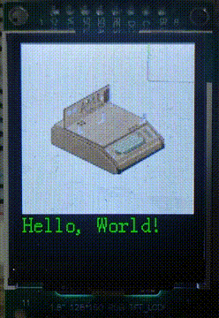
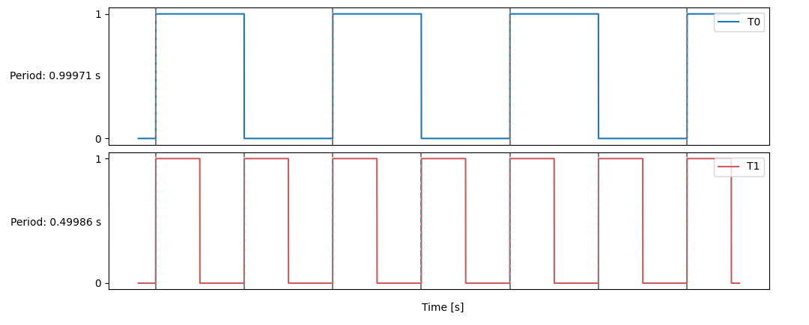

<h1 align="center">

</h1>

<h3 align="center">

<a href="https://github.com/Eplankton/mos-stm32/stargazers"></a>
<a href="https://github.com/Eplankton/mos-stm32/network/members"></a>
<a href="https://github.com/Eplankton/mos-stm32/contributors"></a>
<a href="https://github.com/Eplankton/mos-renode/commits"></a>

**[中文](https://gitee.com/Eplankton/mos-renode) | [English](https://github.com/Eplankton/mos-renode)**

</h3>

> [!NOTE]  
> This project is currently under actively developing and improving, some APIs and interfaces may change as the design continues to mature.

## About 🚀

- **MOS** is a Real-Time Operating System (RTOS) project built in C++/Rust, which consists of a preemptive kernel and a command-line shell with other applications (e.g., **GuiLite** and **FatFS**).

- [**Renode**](https://renode.io/) is a virtual development tool created by [**Antmicro**](https://antmicro.com/) for multi-node embedded networks (both wired and wireless) and is intended to enable a scalable workflow for creating effective, tested and secure IoT systems.

## Repository 🌏

- `mos-core` - The kernel and the shell, check **[here](https://github.com/Eplankton/mos-core)**.
- `mos-stm32` - Running on STM32 series, check **[here](https://github.com/Eplankton/mos-stm32)**.
- `mos-renode` - Test on Renode emulation, check **[here](https://github.com/Eplankton/mos-renode)**.
- `mos-rust` - A "Vibe Coding" Chimera, check **[here](https://github.com/Eplankton/mos-rust)**.

## Start 📦

- ### Dependencies
  - Run `git submodule update --init --recursive`
  - Benchmark submodules are skipped and fetched when a benchmark runs

- ### Toolchain
  - Install **CMake** and the `Arm GNU Toolchain`
  - RISC-V needs the **[xPack RISC-V GCC](https://github.com/xpack-dev-tools/riscv-none-elf-gcc-xpack/releases)**, unpacked under `~/.local/xpacks/`

- ### Build
  ```bash
  ./build.sh                  # board menu
  ./build.sh stm32f4-disco    # stm32h7-disco / riscv32-virt / all / clean
  ```
  - Artifacts in `build/<board>`

- ### Renode emulation
  - Install **[Renode](https://github.com/renode/renode?tab=readme-ov-file#installation)**
  - **Quick demo**: `./emulation/run.sh`, then pick a board and a mode
  - **Self-test**: `./emulation/selftest.sh` (3 boards x 6 policies)
  - **Single machine**: `renode --console examples/boards/<board>/renode/debug.resc`
    - Shell: `TCP localhost:3333`
    - GDB: `localhost:1234`
  - **Multi-machine M2M**: `examples/boards/<board>/renode/multi_mach.resc`
  - Press `F5` in VS Code to debug
  - Details in [emulation/README.md](emulation/README.md)

- ### EIDE (F4 only)
  - Open the repository root to build the F4 example
  - Keep `.eide/eide.yml` in sync with the sources in `board.cmake`

## Performance 📊

- Against **FreeRTOS V11.3.3**: same Renode machine (Cortex-M4F, 100 MIPS, 1 kHz tick, 100 ns timer resolution), same compiler flags and test sources
- Speedup above 1 means MOS performs better

**Thread-Metric**: throughput, operations per second, higher is better

| Test | MOS | FreeRTOS | Speedup |
|---|---:|---:|---:|
| Cooperative scheduling | 1,255,357 | 1,513,615 | 0.83 |
| Preemptive scheduling | 527,038 | 380,932 | 1.38 ✅|
| Interrupt processing | 1,784,401 | 1,218,988 | 1.46 ✅|
| Interrupt preemption | 406,205 | 301,985 | 1.35 ✅|
| Message processing | 876,547 | 707,410 | 1.24 ✅|
| Synchronization (semaphore) | 2,039,315 | 1,218,996 | 1.67 ✅|

**RTOS-Benchmark**: latency of one operation, ns, lower is better

| Operation | MOS | FreeRTOS | Speedup |
|---|---:|---:|---:|
| Semaphore take (context switch) | 900 | 4,100 | 4.56 ✅|
| Semaphore give (context switch) | 1,400 | 2,300 | 1.64 ✅|
| Mutex lock (no owner) | 300 | 800 | 2.67 ✅|
| Mutex pend (priority inheritance) | 1,900 | 5,100 | 2.68 ✅|
| Mutex unlock to a waiter (context switch) | 3,000 | 3,200 | 1.07 ✅|
| Mutex unlock to a waiter (no context switch) | 1,900 | 1,000 | 0.53 |
| Message queue send (context switch) | 2,500 | 2,900 | 1.16 ✅|
| Message queue receive (context switch) | 2,400 | 2,900 | 1.21 ✅|
| Yield (context switch) | 800 | 700 | 0.88 |

- MOS is faster at blocking and waking; FreeRTOS is faster at plain task switching
- Renode is not cycle-accurate; the numbers only compare code path lengths
- Reproduce: `./benchmarks/compare.sh`, full results in [benchmarks/README.md](benchmarks/README.md)

## Manual 📚

- **[用户手册(中文)](manual_zh.pdf) | [Manual(English) from **DeepWiki**](https://deepwiki.com/Eplankton/mos-renode)**

## Architecture 🔍


```
.
├── 📁 core               // Kernel (submodule)
├── 📁 examples           // Examples and board support, see examples/README.md
│   ├── common/           // Shared tests and demos
│   └── boards/           // One directory per board
├── 📁 emulation          // Renode scripts
├── 📁 benchmarks         // Benchmarks and FreeRTOS comparison
├── 📁 vendor/stm32       // CMSIS + HAL/LL
├── build.sh
└── CMakeLists.txt
```

```
core
├── 📁 arch               // Architecture ports
│   ├── cpu.hpp           // Port contract
│   ├── cpu_isr.hpp       // Exception entry
│   ├── cortex_m/         // Cortex-M4/M7
│   └── riscv32/          // RV32
│
├── 📁 kernel             // Kernel layer
│   ├── macro.hpp         // Constants
│   ├── type.hpp          // Basic types
│   ├── concepts.hpp      // Type constraints
│   ├── data_type/        // Basic data structures
│   ├── alloc.hpp         // Memory management
│   ├── global.hpp/.cpp   // Global variables
│   ├── task.hpp          // Task management
│   ├── policy.hpp        // Scheduling policies
│   ├── scheduler.hpp     // Scheduler
│   ├── sync.hpp          // Synchronization primitives
│   ├── ipc.hpp           // Inter-process communication
│   ├── async.hpp         // Async coroutines
│   └── utils.hpp         // Other utilities
│
├── 📁 libc               // printf, newlib stubs
├── 📁 external           // ETL
├── config.h              // System configuration
├── kernel.hpp            // Kernel modules
└── shell.hpp             // Command line
```

## Example 🍎

One example per board, `examples/boards/<board>/main.cpp`:
- Shell + LED + M2M + kernel tests, the same on F4, H7 and RISC-V32 Virtual

```cpp
// examples/boards/stm32f4-disco/main.cpp
#include "board.hpp"
#include "kernel.hpp"
#include "shell.hpp"
#include "common/kernel_tests.hpp"

using namespace MOS;
namespace Board = Boards::STM32F4Disco;

static void led_task()
{
	while (true) {
		Board::led_toggle();
		Kernel::Task::delay(500_ms);
	}
}

// A named coroutine copies its parameters into the frame; a capturing lambda
// coroutine only keeps a reference to its (temporary) closure.
static Kernel::Async::Future_t<> m2m_tx(const char* msg)
{
	while (true) {
		Board::hub().send_line(msg);
		co_await Kernel::Async::delay(500_ms);
	}
}

static void m2m_task()
{
	char msg[]           = "Hej! I'm Mx";
	msg[sizeof(msg) - 2] = Board::machine_id();

	m2m_tx(msg);

	while (true) {
		LOG("rx -> \"%s\"", Board::hub().buf.recv().as_str());
	}
}

int main()
{
	Board::init(); // clocks, GPIO, USART, SysTick

	Kernel::Task::create(Shell::launch<Board::Stdio::max_size()>, &Board::stdio().buf, 0, "shell");
	Kernel::Task::create(led_task, 1, "led");
	Kernel::Task::create(m2m_task, 2, "m2m");

	/* Test examples */
	Kernel::Task::create(Test::MsgQueueTest<3>, 2, "msgq/test");
	Kernel::Task::create(Test::AsyncTest<300>, 2, "async/test");

	Kernel::Scheduler::launch(); // never returns
}
```

Board interface, `board.hpp` (header-only):

```cpp
namespace MOS::Boards::STM32F4Disco
{
	using Stdio = Drivers::SyncUart<Drivers::Stm32Usart, MOS_CONF_SHELL_BUF_SIZE>;
	using Hub   = Drivers::SyncUart<Drivers::Stm32Usart, 32>;

	void init();
	Stdio& stdio();
	Hub& hub();
	void led_toggle();
	char machine_id();
}
```

Boot output:

```plain
 A_A       _   [name]  @ x.x.x(Version)
o'' )_____//   Build   @ TIME, DATE
 `_/  MOS  )   Chip    @ MCU, ARCH
 (_(_/--(_/    2023-2026 Copyright by Eplankton

<Tid> <Name> <Priority> <Status> <Mem%>
---------------------------------------
 #0   shell        0     RUNNING     7%
 #1   led          1     READY       7%
 #2   m2m          2     READY       7%
 #3   msgq/test    2     READY       7%
 #4   async/test   2     READY       7%
 #5   idle         127   READY      15%
---------------------------------------
```

- `Shell Test`


- `Mutex Test(Priority Inheritance Protocol)`


- `LCD Driver & GUI Demo`<br>
<p align="center">
  
 
</p>

- `Concurrent Task Period & Time Sequence`<br>
<p align="center">



</p>

## Scheduling Policies 🧭

Chosen at compile time; all share the same context-switch code:

| Policy | Full name | Ordering key | Preemptive | Notes |
|---|---|---|---|---|
| `RR` | Round-Robin | Arrival order | Time slice | FIFO rotation, priorities ignored |
| `PP` | Preemptive Priority | Priority | Yes | Equal priorities rotate by time slice (default) |
| `RM` | Rate-Monotonic | Period `T` | Yes | Shorter period, higher priority |
| `DM` | Deadline-Monotonic | Relative deadline `D` | Yes | For `D <= T` |
| `EDF` | Earliest-Deadline-First | Absolute deadline | Yes | Schedulable when `ΣC/T <= 1` |
| `COOP` | Cooperative | Priority | No | Switches only on block or `yield()` |

- Set `MOS_CONF_SCHED_POLICY` in `core/config.h`, or `cmake -DMOS_SCHED_POLICY=EDF`

### Periodic tasks

```cpp
static void control_job()
{
	while (true) {
		/* work */
		Kernel::Task::periodic_wait(); // block until the next activation
	}
}

Kernel::Task::create_periodic(
    control_job, nullptr,
    0,      // base priority (RM/DM override it from T/D)
    20_ms,  // period T
    20_ms,  // relative deadline D (0 means D = T)
    "ctrl",
    3_ms    // optional WCET for admission control
);
```

- With a WCET, admission control runs (RM: Liu & Layland, DM: density test, EDF: `ΣC/T <= 1`); on failure it returns `nullptr`
- Missed deadlines: `Task::missed_deadlines()`; demo in `examples/common/sched_demo.hpp`

### Behavioral tests

`examples/common/kernel_tests.hpp`, one `[TEST] ... PASS/FAIL` line per case:

| Case | Policies | Checks |
|---|---|---|
| RR fairness | all | Equal-priority tasks rotate fairly |
| Preemption | PP/RM/DM | Higher priority preempts lower |
| COOP | COOP | A busy task is not preempted |
| Deadline order | RM/DM/EDF | Runs in T/D/deadline order |
| Periodic timing | PP/RM/DM/EDF | Activation interval equals the period |
| Nested PIP | PP/RM/DM | Nested boosts unwind level by level |
| PIP multi-waiter | PP/RM/DM | Several waiters boost the owner in turn |
| PIP unrelated unlock | PP/RM/DM | An unrelated unlock keeps the boost |
| PIP transitive | PP/RM/DM | H waits on M, M on L: L inherits H |
| MsgQueue recheck | all | Re-waits when the slot is taken, no lost message |

### Notes

- RM/DM map periods/deadlines onto priorities `[0, 31]`; use `>= 32` for ordinary tasks
- Under EDF, tasks without a deadline run after periodic ones, round-robin
- `COOP` has no tick preemption; CPU-bound tasks must call `Task::yield()`
- `-DMOS_SCHED_DEMO=ON` builds the policy demo

## Porting 🔌

The kernel reaches the CPU only through `MOS::Arch`, defined in [core/arch/cpu.hpp](core/arch/cpu.hpp); a port missing any of it fails to compile:

| Function | Cortex-M | RV32 (RISC-V32 Virtual) |
|---|---|---|
| `irq_save/irq_restore/irq_enabled` | PRIMASK | `mstatus.MIE` |
| `request_switch()` | pend PendSV | write CLINT `msip` (software interrupt) |
| `start_first()` | `svc 0` | `mret` from the task frame |
| `init_stack()` | hardware frame + R4–R11 (+EXC_RETURN) | 32-word frame: `mepc`/`ra`/`a0`/`mstatus` |
| System tick | SysTick → `Scheduler::tick()` | CLINT `mtimecmp` (rate set by the board, remainder carried for an exact 1 kHz average) |
| `idle_wait()` | `wfi` | `wfi` |

- Each port provides `port.hpp` (primitives) and `port_isr.hpp` (exception entry, context switch)
- New architecture: implement `core/arch/<arch>/`, add a branch to `cpu.hpp`/`cpu_isr.hpp`, then add a board per [examples/README.md](examples/README.md)
- RV32: one entry for all traps; external interrupts go through the PLIC to `mos_external_irq()`

## Milestone 🧾

📦 `v0.5`

> ✅ Done:
> - Added `RM` / `DM` / `EDF` / `COOP` policies, completed `RR`
> - Added periodic tasks `Task::create_periodic` / `Task::periodic_wait` with admission control
> - Shorter scheduler switch path, yield from 101 to 86 instructions
> - Fixed the PendSV-over-SysTick stall and tick-wrap comparisons
> - Priority inheritance tracked per mutex: nested, multiple waiters, transitive
> - Fixed `MsgQueue_t` lost messages and semaphore counts; atomic `CondVar_t::wait`
> - Architecture layer refactored into the `MOS::Arch` contract
> - Added `STM32H747I-DISCO (Cortex-M7)`
> - Ported to RISC-V: Renode's `RISC-V32 Virtual (RV32IMAC)`
> - Board directories `examples/boards/<board>/`, discovered by the scripts
> - Added the `emulation/selftest.sh` self-test
> - Added Thread-Metric, RTOS-Benchmark and the FreeRTOS comparison
> - **[Experimental]** Port to `ESP32-C6(RISC-V)`
> - **[Experimental]** Rewrite it in Rust

📦 `v0.4`

> ✅ Done：
>
> - Add Hardware `FPU` support
> - **CMake Tools** are now available for compiling the project
> - Add external library [**ETL**](https://www.etlcpp.com/), a C++ template library for embedded applications
> - Add `Renode` emulation platform, add stable support for `Cortex-M` series
> - **[Experimental]** Add scheduler lock `Scheduler::suspend()`
> - **[Experimental]** Add Asynchronous stackless coroutines `Async::{Executor, Future_t, co_await/yield/return}`
>
> 📌 Planned: 
>
> - Shift from `FatFS` to `LittleFS`

📦 `v0.3`

> ✅ Done:
>
> - Mapping `Tids` to `BitMap_t`
> - Message queue `IPC::MsgQueue_t`
> - `Task::create` allows generic function signatures as `void fn(auto argv)` with type checker
> - Add `ESP32-C3` as a `WiFi` component
> - Add `Driver::Device::SD_t`, `SD` card driver, porting `FatFs` file system
> - Add `Shell::usr_cmds` for user-registered commands
> - **[Experimental]** Atomic types `<stdatomic.h>`
> - **[Experimental]** `Utils::IrqGuard_t`, nested interrupt critical sections
> - **[Experimental]** Simple formal verification of `Scheduler + Mutex`
>
> 📌 Planned: 
>
> - Inter-Process Communication: pipes/channels
> - `FPU` hardware float support
> - Performance benchmarking
> - Error handling with `Result<T, E>`, `Option<T>`
> - `DMA_t` DMA Driver
> - Software/hardware timers `Timer`
> - **[Experimental]** Adding `POSIX` support
> - **[Experimental]** More real-time scheduling algorithms


📦 `v0.2`

> ✅ Done:
> 
> - Synchronization primitives `Sync::{Sema_t, Lock_t, Mutex_t<T>, CondVar_t, Barrier_t}`
> - `Scheduler::Policy::PreemptPri` with `RoundRobin` scheduling for same priority levels
> - `Task::terminate` implicitly called upon task exit to reclaim resources
> - Simple command-line interaction `Shell::{Command, CmdCall, launch}`
> - `HAL::STM32F4xx::SPI_t` and `Driver::Device::ST7735S_t`, porting the `GuiLite` graphics library
> - Blocking delay with `Kernel::Global::os_ticks` and `Task::delay`
> - Refactored project organization into `{kernel, arch, drivers}`
> - Support for `GCC` compilation, compatible with `STM32Cube HAL`
> - Real-time calendar `HAL::STM32F4xx::RTC_t`, `CmdCall::date_cmd`, `App::Calendar`
> - `idle` uses `Kernel::Global::zombie_list` to reclaim inactive pages
> - Three basic page allocation policies `Page_t::Policy::{POOL, DYNAMIC, STATIC}`


📦 `v0.1`

> ✅ Done:
> 
> - Basic data structures, scheduler, and task control, memory management
>
> 📌 Planned: 
> 
> - Timers, round-robin scheduling
> - Inter-Process Communication (IPC), pipes, message queues
> - Process synchronization (Sync), semaphores, mutexes
> - Design a simple Shell
> - Variable page sizes, memory allocator
> - SPI driver, porting GuiLite/LVGL graphics libraries
> - Porting to other boards/arch, e.g., ESP32-C3 (RISC-V)


## References 🛸
- [How to build a Real-Time Operating System(RTOS)](https://medium.com/@dheeptuck/building-a-real-time-operating-system-rtos-ground-up-a70640c64e93)
- [PeriodicScheduler_Semaphore](https://github.com/Dungyichao/PeriodicScheduler_Semaphore)
- [STM32F4-LCD_ST7735s](https://github.com/Dungyichao/STM32F4-LCD_ST7735s)
- [A printf/sprintf Implementation for Embedded Systems](https://github.com/mpaland/printf)
- [GuiLite](https://github.com/idea4good/GuiLite)
- [STMViewer](https://github.com/klonyyy/STMViewer)
- [FatFs](http://elm-chan.org/fsw/ff)
- [The Zephyr Project](https://www.zephyrproject.org/)
- [Eclipse ThreadX](https://github.com/eclipse-threadx/threadx)
- [Embassy](https://embassy.dev/)
- [Renode](https://renode.io/)
- [Embedded Template Library (ETL)](https://www.etlcpp.com)
---

<p align="center">


</p>

```plain
I hope the Pacific is as blue as it has been in my dreams. 
I hope.

-- Stephen King's "Rita Hayworth and the Shawshank Redemption", 1982
```