<h1 align="center">

</h1>

<h3 align="center">

<a href="https://github.com/Eplankton/mos-stm32/stargazers"></a>
<a href="https://github.com/Eplankton/mos-stm32/network/members"></a>
<a href="https://github.com/Eplankton/mos-stm32/contributors"></a>
<a href="https://github.com/Eplankton/mos-renode/commits"></a>

**[中文](https://gitee.com/Eplankton/mos-renode) | [English](https://github.com/Eplankton/mos-renode)**

</h3>

> [!NOTE]
> 本项目正在积极开发和改进中，随着设计的不断完善，一些 API 和接口可能会发生变化。

## 简介 🚀

- **MOS** 是一个用 C++/Rust 编写的实时操作系统 (Real-Time Operating System, RTOS) 项目，包含一个抢占式内核和简易命令行, 并移植了一些应用层组件 (例如：**GuiLite** 和 **FatFS** 等)。

- [**Renode**](https://renode.io/) 由 [**Antmicro**](https://antmicro.com/) 创建，是一款用于多节点嵌入式网络（有线和无线）的虚拟化平台，旨在实现可扩展的工作流程，开发有效、经过测试且安全的物联网系统。

## 仓库 🌏
- `mos-core` - 内核与简易命令行, **[链接](https://gitee.com/Eplankton/mos-core)**
- `mos-stm32` - 在 STM32 上运行, **[链接](https://gitee.com/Eplankton/mos-stm32)**
- `mos-renode` - 使用 Renode 仿真运行, **[链接](https://gitee.com/Eplankton/mos-renode)**

- `mos-rust` - Vibe Coding 出来的缝合怪, **[链接](https://gitee.com/Eplankton/mos-rust)**

## 启动 📦

- ### 拉取依赖
  - 运行 `git submodule update --init --recursive`
  - STM32 依赖全部由 submodule 管理：`cmsis-core`、`cmsis-device-f4/h7`、`stm32f4xx-hal-driver`、`stm32h7xx-hal-driver`

- ### 使用 CMake（推荐）
  - 安装 **CMake** 和 `Arm GNU Toolchain` 工具链
  - 直接运行 `./build.sh`，按菜单选择板卡
  - 也可以直接指定：
    ```bash
    ./build.sh stm32f4-disco
    ./build.sh stm32h7-disco
    ./build.sh all
    ./build.sh clean
    ```
  - 等价的 CMake 调用：
    ```bash
    cmake -S . -B build/stm32f4-disco -DMOS_BOARD=stm32f4-disco
    cmake --build build/stm32f4-disco -j
    ```
  - 产物位于 `build/<board>`

- ### Renode 仿真
  - 安装 **[Renode](https://github.com/renode/renode?tab=readme-ov-file#installation)**
  - **快速演示**：`./emulation/run.sh`，按提示选择板卡和模式（自动编译并启动）
  - 详细说明见 [emulation/README.md](emulation/README.md)
  - **F4 单机**：`renode --console emulation/stm32f4-disco/debug.resc`
    - Shell：`TCP localhost:3333`
    - GDB：`localhost:1234`
  - **H7 单机**：`renode --console emulation/stm32h7-disco/debug.resc`
    - Shell：`TCP localhost:3333`（USART1）
    - GDB：`localhost:1234`
    - H7 当前以 HSI 64 MHz 启动；Renode 的 USART1/6 模型固定为 200 MHz，板级代码默认按 200 MHz 计算波特率。真实板卡可用 `-DMOS_H7_UART_CLOCK=<PCLK2>` 覆盖
  - **多机 M2M**：
    - F4：`emulation/stm32f4-disco/multi_mach.resc`
    - H7：`emulation/stm32h7-disco/multi_mach.resc`
  - VS Code 中按 `F5`，选择 `Cortex Debug (F4)` 或 `Cortex Debug (H7)`

- ### 使用 EIDE（旧版 F4 工作流）
  - EIDE 配置仍保留在 `.eide/`，但多平台构建以 CMake 为准；如需 EIDE，请按 `examples/` 与 `vendor/stm32/` 的新布局重新配置

## 文档 📚

- **[用户手册(中文)](manual_zh.pdf) | [Manual(English) from **DeepWiki**](https://deepwiki.com/Eplankton/mos-renode)**


## 架构 🔍

```
.
├── 📁 emulation             // Renode 仿真脚本
├── 📁 examples              // 例程与板级支持
│   ├── common/              // UART 驱动、平台头文件、共享测试
│   └── boards/
│       ├── stm32f4-disco/   // main.cpp / board.hpp / HAL conf / linker
│       └── stm32h7-disco/
├── 📁 vendor/stm32          // CMSIS + HAL/LL 依赖
├── 📁 core
│   ├── 📁 external          // 外部库
│   ├── 📁 arch              // 架构相关
│   │   ├── cpu.hpp          // 架构头文件入口
│   │   └── cortex_m.hpp     // 上下文切换
│   │
│   ├── 📁 kernel            // 内核层
│   │   ├── macro.hpp        // 内核常量宏
│   │   ├── type.hpp         // 基础类型
│   │   ├── concepts.hpp     // 类型约束
│   │   ├── data_type.hpp    // 基本数据结构
│   │   ├── alloc.hpp        // 内存管理
│   │   ├── global.hpp       // 内核全局变量声明
│   │   ├── global.cpp       // 内核全局变量定义
│   │   ├── printf.h/.c      // 线程安全的 printf
│   │   ├── task.hpp         // 任务控制
│   │   ├── sync.hpp         // 同步原语
│   │   ├── async.hpp        // 异步协程
│   │   ├── scheduler.hpp    // 调度器
│   │   ├── ipc.hpp          // 进程间通信
│   │   └── utils.hpp        // 其他工具
│   │
│   ├── config.h             // 系统配置
│   ├── kernel.hpp           // 内核模块
│   └── shell.hpp            // Shell 命令行
```

## 示例 🍎

`examples/` 下每块板一个可独立编译的例程，结构说明见 [examples/README.md](examples/README.md)：

| 例程 | 说明 |
|---|---|
| `boards/stm32f4-disco/main.cpp` | F4：Shell + LED + M2M + 内核测试 |
| `boards/stm32h7-disco/main.cpp` | H7：Shell + LED + M2M + 内核测试 |

```bash
./build.sh stm32f4-disco
./build.sh stm32h7-disco
```

- `Shell交互`
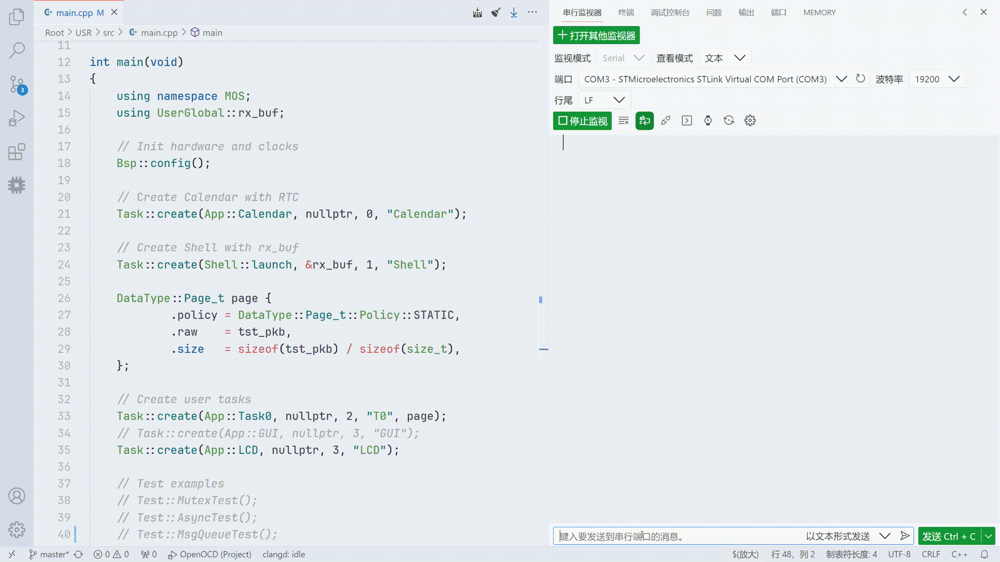

- `Mutex测试(优先级天花板协议)`
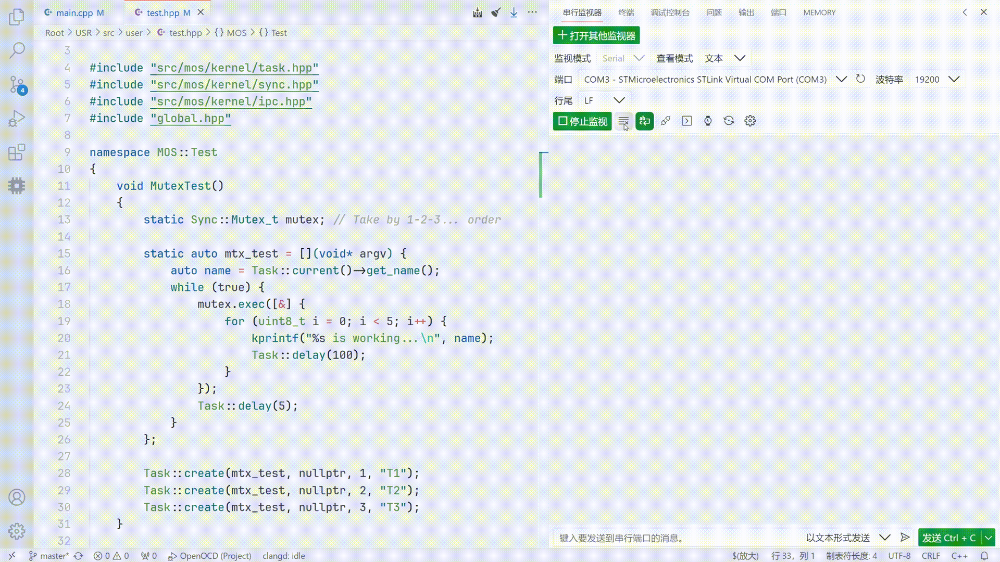

- `LCD驱动与GUI`<br>
<p align="center">
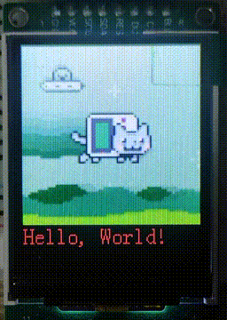 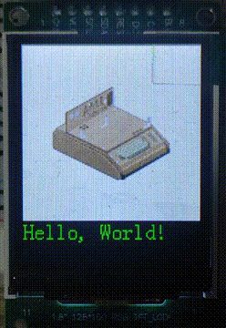 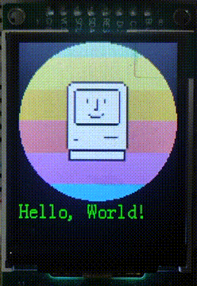
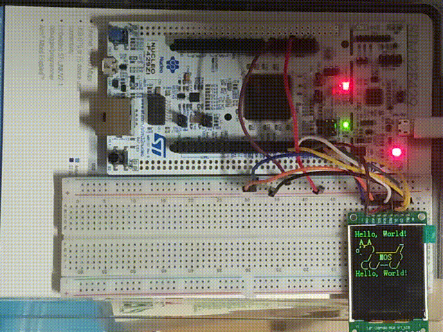 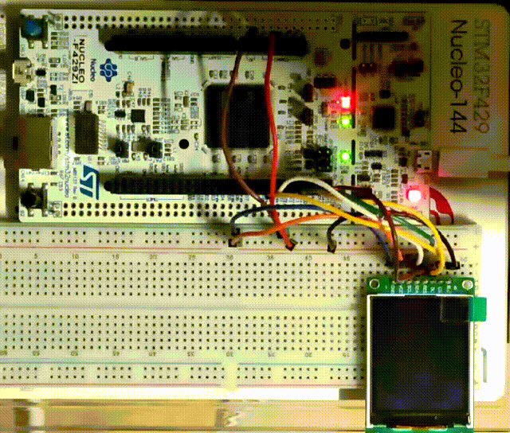
</p>

- `并发任务周期与抢占`<br>
<p align="center">
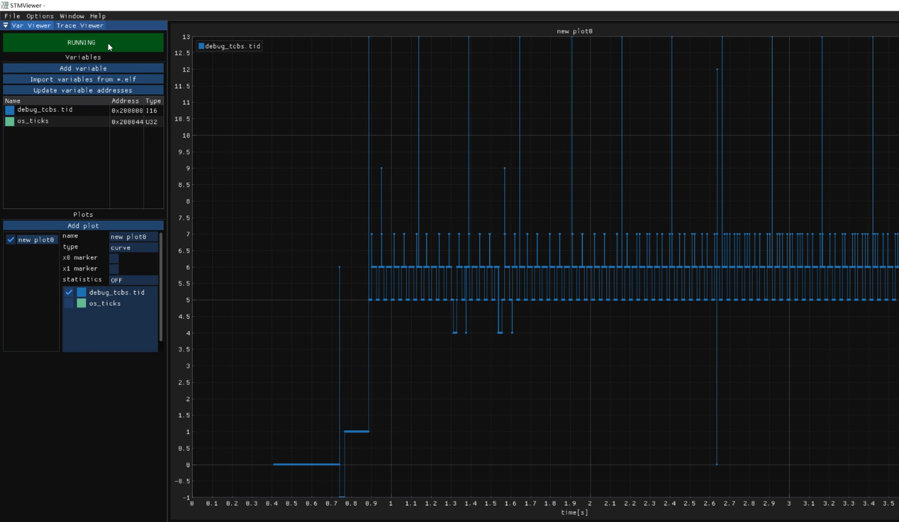
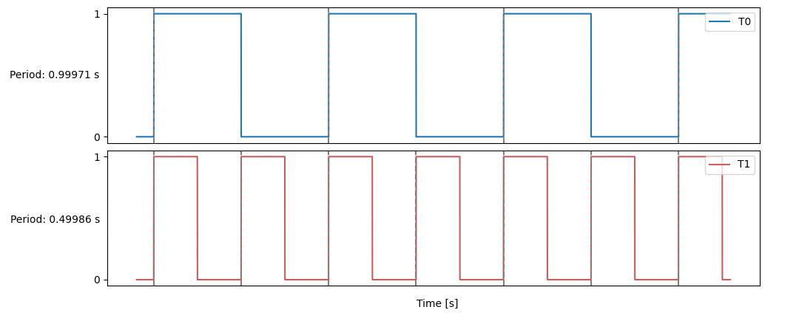
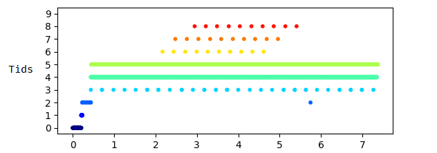
</p>

```cpp
// 例程入口：examples/boards/stm32f4-disco/main.cpp
#include "board.hpp"
#include "kernel.hpp"
#include "shell.hpp"
#include "common/tests.hpp"

using namespace MOS;
namespace Board = Boards::STM32F4Disco;

static void led_task()
{
	while (true) {
		Board::led_toggle();
		Kernel::Task::delay(500_ms);
	}
}

static void m2m_task()
{
	char msg[]           = "Hej! I'm Mx";
	msg[sizeof(msg) - 2] = Board::machine_id();

	[&] -> Kernel::Async::Future_t<> {
		while (true) {
			Board::hub().send_line(msg);
			co_await Kernel::Async::delay(500_ms);
		}
	}();

	while (true) {
		LOG("rx -> \"%s\"", Board::hub().buf.recv().as_str());
	}
}

int main()
{
	Board::init(); // 时钟、GPIO、USART、SysTick

	Kernel::Task::create(Shell::launch<Board::Stdio::max_size()>, &Board::stdio().buf, 0, "shell");
	Kernel::Task::create(led_task, nullptr, 1, "led");
	Kernel::Task::create(m2m_task, nullptr, 2, "m2m");

	/* 测试例程 */
	Kernel::Task::create(Examples::Test::MsgQueueTest<3>, nullptr, 2, "msgq/test");
	Kernel::Task::create(Examples::Test::AsyncTest<300>, nullptr, 2, "async/test");

	Kernel::Scheduler::launch(); // 启动调度器，不返回
}
```

板级实现位于 `examples/boards/<board>/board.hpp`（header-only）：

```cpp
namespace MOS::Boards::STM32F4Disco
{
	using Stdio = Common::SyncUart<MOS_CONF_SHELL_BUF_SIZE>;
	using Hub   = Common::SyncUart<32>;

	void init();
	Stdio& stdio();
	Hub& hub();
	void led_toggle();
	char machine_id();
}
```

## 启动 ⚡
```plain
 A_A       _   [name]  @ x.x.x(Version)
o'' )_____//   Build   @ TIME, DATE
 `_/  MOS  )   Chip    @ MCU, ARCH
 (_(_/--(_/    2023-2026 Copyright by Eplankton

<Tid> <Name> <Priority> <Status> <Mem%>
---------------------------------------
 #0   shell        0     RUNNING     7%
 #1   led          1     READY       7%
 #2   m2m          2     READY       7%
 #3   msgq/test    2     READY       7%
 #4   async/test   2     READY       7%
 #5   idle         127   READY      15%
---------------------------------------
```

## 调度策略 🧭

内核在编译期选择一种调度策略（`Kernel::Policy`），不同策略共享同一套上下文切换代码，无运行时开销：

| 策略 | 就绪队列排序键 | 抢占 | 说明 |
|---|---|---|---|
| `RoundRobin` | 到达顺序 | 时间片 | 忽略优先级，FIFO 轮转 |
| `PreemptPri` | 静态优先级 | 是 | 同优先级内时间片轮转（默认） |
| `RateMonotonic` (RM) | 周期 `T` | 是 | 周期越短优先级越高；`D = T` 时固定优先级最优 |
| `DeadlineMonotonic` (DM) | 相对截止期 `D` | 是 | RM 的推广，适用于 `D <= T` |
| `EarliestDeadlineFirst` (EDF) | 绝对截止期 | 是 | 单核可抢占最优，`ΣC/T <= 1` 即可调度 |
| `Cooperative` (Coop) | 静态优先级 | 否 | 仅在阻塞或主动 `Task::yield()` 时切换 |

在 `core/config.h` 中选择：

```c
#define MOS_CONF_SCHED_POLICY EarliestDeadlineFirst
```

也可以直接通过 CMake 覆盖，无需修改源码：

```bash
cmake -S . -B build/stm32f4-disco -DMOS_SCHED_POLICY=EarliestDeadlineFirst
```

默认仍为 `PreemptPri`，行为与旧版本一致。

### 周期任务

```cpp
static void control_job()
{
	while (true) {
		/* work */
		Kernel::Task::periodic_wait(); // 阻塞到下一次激活
	}
}

Kernel::Task::create_periodic(
    control_job, nullptr,
    0,      // 基础优先级（RM/DM 会按 T/D 覆盖）
    20_ms,  // 周期 T
    20_ms,  // 相对截止期 D（0 表示等于周期）
    "ctrl",
    3_ms    // 可选 WCET，用于准入检查
);
```

- 首个作业在创建时立即激活；此后每次 `periodic_wait()` 唤醒时刷新绝对截止期 `dl_abs = 激活时刻 + D`。
- 提供 WCET 时执行准入检查：RM 使用 Liu & Layland 上界，DM 使用密度测试，EDF 使用 `ΣC/T <= 1`；不通过则返回 `nullptr`。
- 每个作业的截止期丢失只记一次，可通过 `Task::missed_deadlines()` 查询。示例见 `examples/common/sched_test.hpp`。

### 行为测试

`examples/common/tests.hpp` 的 `SchedPolicyTest()` 随默认构建自动运行，按策略编译期选择用例，每个用例打印一行 `[TEST] ... PASS/FAIL`：

| 用例 | 适用策略 | 验证内容 |
|---|---|---|
| RR fairness | 全部 | 同优先级（同截止期）任务公平轮转，CPU 份额差异 < 40% |
| Preemption | PreemptPri/RM/DM | 高优先级任务抢占正忙的低优先级任务 |
| Cooperative | Cooperative | 忙碌任务完成前高优先级任务得不到 CPU |
| Deadline order | RM/DM/EDF | 按 T/D/绝对截止期排序运行（逆序创建），RM/DM 校验派生优先级 |
| Periodic timing | PreemptPri/RM/DM/EDF | 激活间隔 ≈ 周期，EDF 下无截止期丢失 |
| Nested PIP | PreemptPri/RM/DM | 嵌套互斥锁的优先级提升逐层回退，中优先级不发生反转 |

### 说明

- RM/DM 用 `floor(log2(T))` 将周期/截止期映射到优先级 `[0, 31]`，普通任务建议使用 `>= 32` 的优先级。
- EDF 下没有截止期的任务（`Task::create`）排在周期任务之后，并以时间片轮转，不会被饿死。
- `Cooperative` 没有 tick 抢占，CPU 密集型任务必须显式调用 `Task::yield()`。
- 优先级继承（PIP）支持嵌套加锁，深度由 `MOS_CONF_PRI_STACK_DEPTH` 配置。
- 使用 `-DMOS_SCHED_DEMO=ON`（或 `MOS_SCHED_DEMO=ON ./build.sh <board>`）构建策略演示；该构建会跳过 `msgq/test` 与 `async/test` 两个压力测试，以免占满页面池并淹没串口输出。

## 里程碑 📜

📦 `v0.5`

> ✅ 完成：
> - 新增调度策略 `RateMonotonic` / `DeadlineMonotonic` / `EarliestDeadlineFirst` / `Cooperative`，补全 `RoundRobin`
> - 新增周期任务 API `Task::create_periodic` / `Task::periodic_wait` 与可调度性检查
> - 修复 PendSV 抢占 SysTick 导致的调度停摆、嵌套优先级继承与 tick 回绕比较
> - **[实验性]** 移植到 `ESP32-C6(RISC-V)`
> - **[实验性]** 使用 `Rust` 重写
> - 支持 `STM32H747I-DISCO (Cortex-M7)`，与 F4 共用同一套内核
> - STM32 HAL/CMSIS 依赖改为 git submodule 管理
> - 例程按板卡组织为 `examples/boards/<board>/main.cpp`

📦 `v0.4`

> ✅ 完成：
> - 添加 `FPU` 硬件浮点支持
> - 可使用 **CMake Tools** 编译项目
> - 引入嵌入式 C++ 模板库 [**ETL**](https://www.etlcpp.com/)
> - 开发平台迁移，使用 `Renode` 仿真平台, 稳定支持 `Cortex-M` 系列
> - **[实验性]** 添加调度器锁 `Scheduler::suspend()`
> - **[实验性]** 添加异步无栈(Stackless)协程 `Async::{Executor, Future_t, co_await...}`
>
> 📌 计划： 
>
> - 从 `FatFS` 迁移到 `LittleFS`


📦 `v0.3`

> ✅ 完成：
>
> - `Tids` 映射到 `BitMap_t`
> - `IPC::MsgQueue_t`，消息队列
> - `Task::create` 允许泛型函数签名为 `void fn(auto argv)`，提供类型检查
> - 添加 `ESP32-C3` 作为 `WiFi` 元件
> - 添加 `Driver::Device::SD_t`，`SD`卡驱动，移植 `FatFs` 文件系统
> - 添加 `Shell::usr_cmds`，用户注册命令
> - **[实验性]** 原子类型 `<stdatomic.h>`
> - **[实验性]** `Utils::IrqGuard_t`，嵌套中断临界区
> - **[实验性]** `Scheduler + Mutex` 简单的形式化验证
>
> 📌 计划： 
>
> - 进程间通信：管道/通道
> - 性能基准测试
> - `Result<T, E>, Option<T>`，错误处理
> - `DMA_t` 驱动
> - 软/硬件定时器 `Timer`
> - **[实验性]** 添加 `POSIX` 支持
> - **[实验性]** 更多实时调度算法


📦 `v0.2`

> ✅ 完成：
> 
> - `Sync::{Sema_t, Lock_t, Mutex_t<T>, CondVar_t, Barrier_t}` 同步原语
> - `Scheduler::Policy::PreemptPri`，在相同优先级下则以时间片轮转 `RoundRobin` 调度
> - `Task::terminate` 在任务退出时隐式调用，回收资源
> - `Shell::{Command, CmdCall, launch}`，简单的命令行交互
> - `HAL::STM32F4xx::SPI_t` 和 `Driver::Device::ST7735S_t`, 移植 `GuiLite` 图形库
> - `Kernel::Global::os_ticks` 和 `Task::delay`，阻塞延时
> - 重构项目组织为 `{kernel, arch, drivers}`
> - 支持 `GCC` 编译，兼容 `STM32Cube HAL`
> - `HAL::STM32F4xx::RTC_t`, `CmdCall::date_cmd`, `App::Calendar` 实时日历
> - `idle` 使用 `Kernel::Global::zombie_list` 回收非活动页面
> - 三种基本的页面分配策略 `Page_t::Policy::{POOL(池), DYNAMIC(动态), STATIC(静态)}`


📦 `v0.1`

> ✅ 完成：
> 
> - 基本的数据结构、调度器与任务控制、内存管理
>
> 📌 计划： 
> 
> - 定时器，时间片轮转调度
> - 进程间通信 `IPC`，管道、消息队列
> - 进程同步 `Sync`，信号量、互斥锁
> - 移植简单的 `Shell`
> - 可变页面大小，内存分配器
> - `SPI` 驱动，移植 `GuiLite/LVGL` 图形库
> - 移植到其他开发板/架构，例如 `ESP32-C3(RISC-V)`


## 参考资料 🛸
- [How to build a Real-Time Operating System(RTOS)](https://medium.com/@dheeptuck/building-a-real-time-operating-system-rtos-ground-up-a70640c64e93)
- [PeriodicScheduler_Semaphore](https://github.com/Dungyichao/PeriodicScheduler_Semaphore)
- [STM32F4-LCD_ST7735s](https://github.com/Dungyichao/STM32F4-LCD_ST7735s)
- [A printf/sprintf Implementation for Embedded Systems](https://github.com/mpaland/printf)
- [GuiLite](https://github.com/idea4good/GuiLite)
- [STMViewer](https://github.com/klonyyy/STMViewer)
- [FatFs](http://elm-chan.org/fsw/ff)
- [The Zephyr Project](https://www.zephyrproject.org/)
- [Eclipse ThreadX](https://github.com/eclipse-threadx/threadx)
- [Embassy](https://embassy.dev/)
- [Renode](https://renode.io/)
- [Embedded Template Library (ETL)](https://www.etlcpp.com)
---

<p align="center">
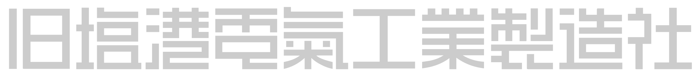

</p>

```plain
I hope the Pacific is as blue as it has been in my dreams. 
I hope.

-- Stephen King's "Rita Hayworth and the Shawshank Redemption", 1982
```