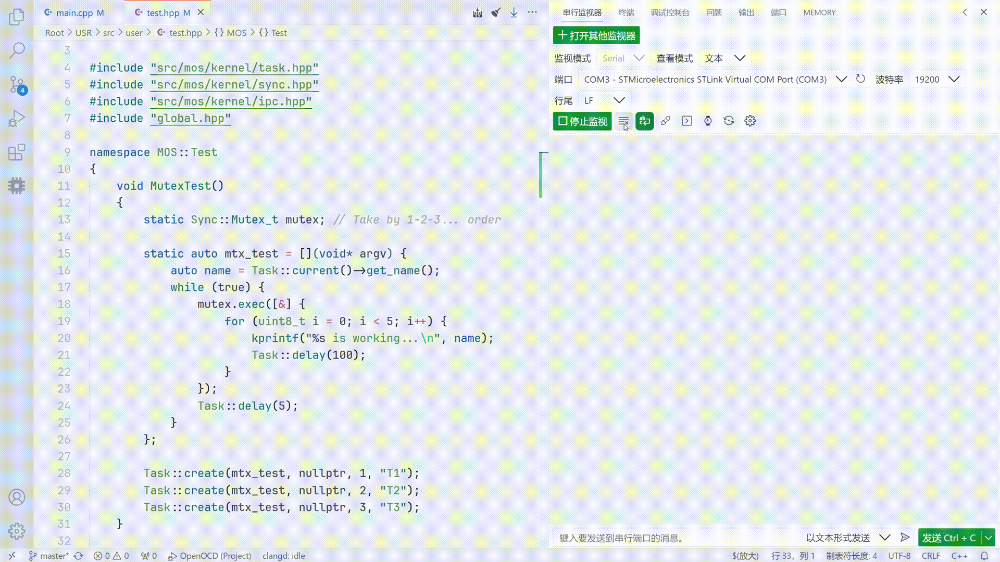
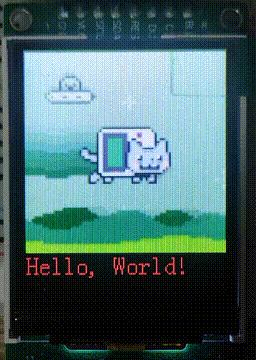
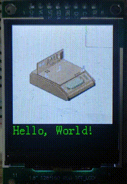
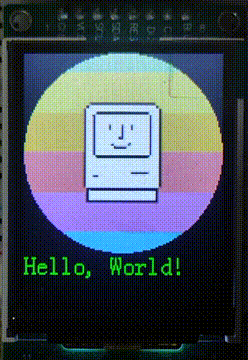
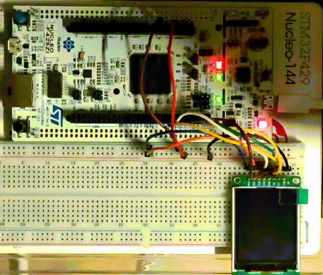
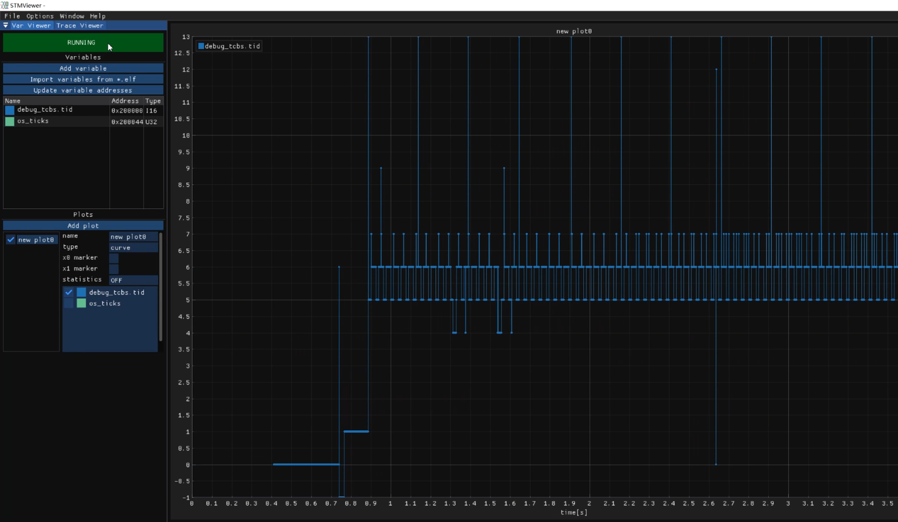
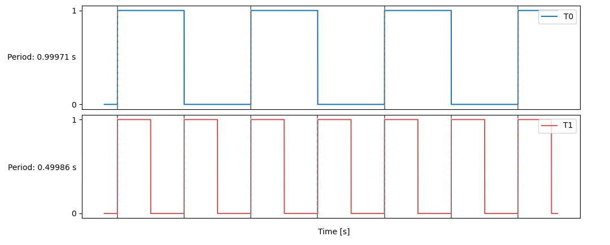
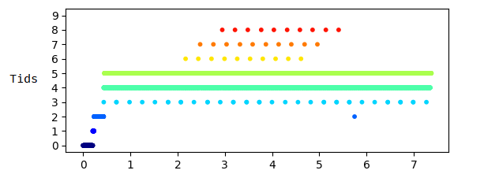
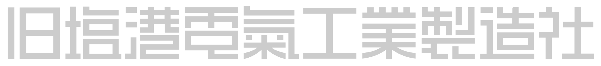

<h1 align="center">

</h1>

<h3 align="center">

<a href="https://github.com/Eplankton/mos-stm32/stargazers"></a>
<a href="https://github.com/Eplankton/mos-stm32/network/members"></a>
<a href="https://github.com/Eplankton/mos-stm32/contributors"></a>
<a href="https://github.com/Eplankton/mos-renode/commits"></a>

**[中文](https://gitee.com/Eplankton/mos-renode) | [English](https://github.com/Eplankton/mos-renode)**

</h3>

> [!NOTE]
> 本项目正在积极开发和改进中，随着设计的不断完善，一些 API 和接口可能会发生变化。

## 简介 🚀

- **MOS** 是一个用 C++/Rust 编写的实时操作系统 (Real-Time Operating System, RTOS) 项目，包含一个抢占式内核和简易命令行，并移植了一些应用层组件（例如 **GuiLite** 和 **FatFS**）。

- [**Renode**](https://renode.io/) 由 [**Antmicro**](https://antmicro.com/) 创建，是一款用于多节点嵌入式网络（有线和无线）的虚拟化平台，旨在实现可扩展的工作流程，开发有效、经过测试且安全的物联网系统。

## 仓库 🌏

- `mos-core` - 内核与简易命令行，**[链接](https://gitee.com/Eplankton/mos-core)**
- `mos-stm32` - 在 STM32 上运行，**[链接](https://gitee.com/Eplankton/mos-stm32)**
- `mos-renode` - 使用 Renode 仿真运行，**[链接](https://gitee.com/Eplankton/mos-renode)**
- `mos-rust` - Vibe Coding 出来的缝合怪，**[链接](https://gitee.com/Eplankton/mos-rust)**

## 启动 📦

- ### 拉取依赖
  - 运行 `git submodule update --init --recursive`
  - 基准测试的子模块默认不拉取，运行基准时自动拉取

- ### 工具链
  - 安装 **CMake** 和 `Arm GNU Toolchain`
  - RISC-V 需要 **[xPack RISC-V GCC](https://github.com/xpack-dev-tools/riscv-none-elf-gcc-xpack/releases)**，解压到 `~/.local/xpacks/` 即可

- ### 构建
  ```bash
  ./build.sh                  # 菜单选择板卡
  ./build.sh stm32f4-disco    # stm32h7-disco / riscv32-virt / all / clean
  ```
  - 产物位于 `build/<board>`

- ### Renode 仿真
  - 安装 **[Renode](https://github.com/renode/renode?tab=readme-ov-file#installation)**
  - **快速演示**：`./emulation/run.sh`，按提示选择板卡和模式
  - **自测**：`./emulation/selftest.sh`（3 块板 × 6 种调度策略）
  - **单机**：`renode --console examples/boards/<board>/renode/debug.resc`
    - Shell：`TCP localhost:3333`
    - GDB：`localhost:1234`
  - **多机 M2M**：`examples/boards/<board>/renode/multi_mach.resc`
  - VS Code 中按 `F5` 调试
  - 详细说明见 [emulation/README.md](emulation/README.md)

- ### 使用 EIDE（仅 STM32F4）
  - 打开项目根目录即可构建 F4 示例
  - 修改 `board.cmake` 的源文件时同步 `.eide/eide.yml`

## 性能 📊

- 对比 **FreeRTOS V11.3.3**：同一台 Renode 机器（Cortex-M4F，100 MIPS，1 kHz tick，计时分辨率 100 ns），同样的编译选项与测试源码
- 加速比大于 1 表示 MOS 表现更好

**Thread-Metric**：吞吐量，次/秒，越高越好

| 测试 | MOS | FreeRTOS | 加速比 |
|---|---:|---:|---:|
| 协作调度 | 1,255,357 | 1,513,615 | 0.83 |
| 抢占调度 | 527,038 | 380,932 | 1.38 ✅|
| 中断处理 | 1,784,401 | 1,218,988 | 1.46 ✅|
| 中断抢占 | 406,205 | 301,985 | 1.35 ✅|
| 消息收发 | 876,547 | 707,410 | 1.24 ✅|
| 同步（信号量） | 2,039,315 | 1,218,996 | 1.67 ✅|

**RTOS-Benchmark**：单次操作延迟，ns，越低越好

| 操作 | MOS | FreeRTOS | 加速比 |
|---|---:|---:|---:|
| 信号量获取（发生切换） | 900 | 4,100 | 4.56 ✅|
| 信号量释放（发生切换） | 1,400 | 2,300 | 1.64 ✅|
| 互斥量加锁（无人持有） | 300 | 800 | 2.67 ✅|
| 互斥量等待（优先级继承） | 1,900 | 5,100 | 2.68 ✅|
| 互斥量移交给等待者（发生切换） | 3,000 | 3,200 | 1.07 ✅|
| 互斥量移交给等待者（不切换） | 1,900 | 1,000 | 0.53 |
| 消息队列发送（发生切换） | 2,500 | 2,900 | 1.16 ✅|
| 消息队列接收（发生切换） | 2,400 | 2,900 | 1.21 ✅|
| Yield（发生切换） | 800 | 700 | 0.88 |

- MOS 在阻塞与唤醒类操作上更快；FreeRTOS 在单纯的任务切换上更快
- Renode 不是周期精确的模拟器，数字只反映代码路径的相对长短
- 复现：`./benchmarks/compare.sh`，完整数据见 [benchmarks/README.md](benchmarks/README.md)

## 文档 📚

- **[用户手册(中文)](manual_zh.pdf) | [Manual(English) from **DeepWiki**](https://deepwiki.com/Eplankton/mos-renode)**

## 架构 🔍


```
.
├── 📁 core               // 内核（子模块）
├── 📁 examples           // 例程与板级支持，见 examples/README.md
│   ├── common/           // 共享测试与演示
│   └── boards/           // 每块板一个目录
├── 📁 emulation          // Renode 仿真脚本
├── 📁 benchmarks         // 基准测试与 FreeRTOS 对比
├── 📁 vendor/stm32       // CMSIS + HAL/LL
├── build.sh
└── CMakeLists.txt
```

```
core
├── 📁 arch               // 架构移植层
│   ├── cpu.hpp           // 移植接口
│   ├── cpu_isr.hpp       // 异常入口
│   ├── cortex_m/         // Cortex-M4/M7
│   └── riscv32/          // RV32
│
├── 📁 kernel             // 内核层
│   ├── macro.hpp         // 常量
│   ├── type.hpp          // 基础类型
│   ├── concepts.hpp      // 类型约束
│   ├── data_type/        // 基本数据结构
│   ├── alloc.hpp         // 内存管理
│   ├── global.hpp/.cpp   // 全局变量
│   ├── task.hpp          // 任务控制
│   ├── policy.hpp        // 调度策略
│   ├── scheduler.hpp     // 调度器
│   ├── sync.hpp          // 同步原语
│   ├── ipc.hpp           // 进程间通信
│   ├── async.hpp         // 异步协程
│   └── utils.hpp         // 其他工具
│
├── 📁 libc               // printf、newlib 存根
├── 📁 external           // ETL
├── config.h              // 系统配置
├── kernel.hpp            // 内核模块
└── shell.hpp             // 命令行
```

## 示例 🍎

每块板一个例程 `examples/boards/<board>/main.cpp`：
- Shell + LED + M2M + 内核测试，F4、H7、RISC-V32 Virtual 相同

```cpp
// examples/boards/stm32f4-disco/main.cpp
#include "board.hpp"
#include "kernel.hpp"
#include "shell.hpp"
#include "common/kernel_tests.hpp"

using namespace MOS;
namespace Board = Boards::STM32F4Disco;

static void led_task()
{
	while (true) {
		Board::led_toggle();
		Kernel::Task::delay(500_ms);
	}
}

// 具名协程会把参数拷贝进协程帧；带捕获的 lambda 协程只保存闭包引用，闭包是临时对象
static Kernel::Async::Future_t<> m2m_tx(const char* msg)
{
	while (true) {
		Board::hub().send_line(msg);
		co_await Kernel::Async::delay(500_ms);
	}
}

static void m2m_task()
{
	char msg[]           = "Hej! I'm Mx";
	msg[sizeof(msg) - 2] = Board::machine_id();

	m2m_tx(msg);

	while (true) {
		LOG("rx -> \"%s\"", Board::hub().buf.recv().as_str());
	}
}

int main()
{
	Board::init(); // 时钟、GPIO、USART、SysTick

	Kernel::Task::create(Shell::launch<Board::Stdio::max_size()>, &Board::stdio().buf, 0, "shell");
	Kernel::Task::create(led_task, 1, "led");
	Kernel::Task::create(m2m_task, 2, "m2m");

	/* 测试例程 */
	Kernel::Task::create(Test::MsgQueueTest<3>, 2, "msgq/test");
	Kernel::Task::create(Test::AsyncTest<300>, 2, "async/test");

	Kernel::Scheduler::launch(); // 启动调度器，不返回
}
```

板级接口 `board.hpp`（header-only）：

```cpp
namespace MOS::Boards::STM32F4Disco
{
	using Stdio = Drivers::SyncUart<Drivers::Stm32Usart, MOS_CONF_SHELL_BUF_SIZE>;
	using Hub   = Drivers::SyncUart<Drivers::Stm32Usart, 32>;

	void init();
	Stdio& stdio();
	Hub& hub();
	void led_toggle();
	char machine_id();
}
```

启动输出：

```plain
 A_A       _   [name]  @ x.x.x(Version)
o'' )_____//   Build   @ TIME, DATE
 `_/  MOS  )   Chip    @ MCU, ARCH
 (_(_/--(_/    2023-2026 Copyright by Eplankton

<Tid> <Name> <Priority> <Status> <Mem%>
---------------------------------------
 #0   shell        0     RUNNING     7%
 #1   led          1     READY       7%
 #2   m2m          2     READY       7%
 #3   msgq/test    2     READY       7%
 #4   async/test   2     READY       7%
 #5   idle         127   READY      15%
---------------------------------------
```

- `Shell交互`


- `Mutex测试(优先级继承协议)`


- `LCD驱动与GUI`<br>
<p align="center">
  
 
</p>

- `并发任务周期与抢占`<br>
<p align="center">



</p>

## 调度策略 🧭

编译期选择，共享同一套上下文切换代码：

| 策略 | 全称 | 排序键 | 抢占 | 说明 |
|---|---|---|---|---|
| `RR` | Round-Robin | 到达顺序 | 时间片 | FIFO 轮转，忽略优先级 |
| `PP` | Preemptive Priority | 优先级 | 是 | 同优先级时间片轮转（默认） |
| `RM` | Rate-Monotonic | 周期 `T` | 是 | 周期越短优先级越高 |
| `DM` | Deadline-Monotonic | 相对截止期 `D` | 是 | 适用于 `D <= T` |
| `EDF` | Earliest-Deadline-First | 绝对截止期 | 是 | `ΣC/T <= 1` 即可调度 |
| `COOP` | Cooperative | 优先级 | 否 | 仅在阻塞或 `yield()` 时切换 |

- 在 `core/config.h` 中设置 `MOS_CONF_SCHED_POLICY`，或 `cmake -DMOS_SCHED_POLICY=EDF`

### 周期任务

```cpp
static void control_job()
{
	while (true) {
		/* work */
		Kernel::Task::periodic_wait(); // 阻塞到下一次激活
	}
}

Kernel::Task::create_periodic(
    control_job, nullptr,
    0,      // 基础优先级（RM/DM 会按 T/D 覆盖）
    20_ms,  // 周期 T
    20_ms,  // 相对截止期 D（0 表示等于周期）
    "ctrl",
    3_ms    // 可选 WCET，用于准入检查
);
```

- 提供 WCET 时做准入检查（RM：Liu & Layland，DM：密度测试，EDF：`ΣC/T <= 1`），不通过返回 `nullptr`
- 截止期丢失次数：`Task::missed_deadlines()`，示例见 `examples/common/sched_demo.hpp`

### 行为测试

`examples/common/kernel_tests.hpp`，每个用例打印 `[TEST] ... PASS/FAIL`：

| 用例 | 策略 | 验证内容 |
|---|---|---|
| RR fairness | 全部 | 同优先级任务公平轮转 |
| Preemption | PP/RM/DM | 高优先级抢占低优先级 |
| COOP | COOP | 忙碌任务完成前不被抢占 |
| Deadline order | RM/DM/EDF | 按 T/D/截止期顺序运行 |
| Periodic timing | PP/RM/DM/EDF | 激活间隔等于周期 |
| Nested PIP | PP/RM/DM | 嵌套锁的优先级逐层回退 |
| PIP multi-waiter | PP/RM/DM | 多个等待者先后提升持有者 |
| PIP unrelated unlock | PP/RM/DM | 无关解锁不撤销提升 |
| PIP transitive | PP/RM/DM | H 等 M、M 等 L 时 L 继承 H |
| MsgQueue recheck | 全部 | 空位被抢走时重新等待，不丢消息 |

### 说明

- RM/DM 把周期/截止期映射到优先级 `[0, 31]`，普通任务建议用 `>= 32`
- EDF 下无截止期的任务排在周期任务之后，时间片轮转
- `COOP` 没有 tick 抢占，CPU 密集任务需主动 `Task::yield()`
- `-DMOS_SCHED_DEMO=ON` 构建策略演示

## 移植 🔌

内核只通过 `MOS::Arch` 接口访问 CPU，约定见 [core/arch/cpu.hpp](core/arch/cpu.hpp)，缺少任何一项会编译报错：

| 接口 | Cortex-M | RV32（RISC-V32 Virtual） |
|---|---|---|
| `irq_save/irq_restore/irq_enabled` | PRIMASK | `mstatus.MIE` |
| `request_switch()` | 挂起 PendSV | 写 CLINT `msip`（软件中断） |
| `start_first()` | `svc 0` | 从任务帧 `mret` |
| `init_stack()` | 硬件栈帧 + R4–R11 (+EXC_RETURN) | 32 字帧：`mepc`/`ra`/`a0`/`mstatus` |
| 系统 tick | SysTick → `Scheduler::tick()` | CLINT `mtimecmp`（频率由板卡设定，余数累加保证平均 1 kHz） |
| `idle_wait()` | `wfi` | `wfi` |

- 每个移植提供 `port.hpp`（原语）和 `port_isr.hpp`（异常入口与上下文切换）
- 新增架构：实现 `core/arch/<arch>/`，在 `cpu.hpp`/`cpu_isr.hpp` 中加分支，再按 [examples/README.md](examples/README.md) 添加板卡
- RV32：所有 trap 共用一个入口；外部中断经 PLIC 分发到 `mos_external_irq()`

## 里程碑 📜

📦 `v0.5`

> ✅ 完成：
> - 新增调度策略 `RM` / `DM` / `EDF` / `COOP`，补全 `RR`
> - 新增周期任务 `Task::create_periodic` / `Task::periodic_wait` 与准入检查
> - 优化调度器切换路径，yield 指令数从 101 降到 86
> - 修复 PendSV 抢占 SysTick 导致的停摆、tick 回绕比较
> - 优先级继承改为按互斥量跟踪，支持嵌套、多等待者与传递继承
> - 修复 `MsgQueue_t` 丢消息、信号量计数，`CondVar_t::wait` 原子化
> - 架构层重构为 `MOS::Arch` 接口
> - 支持 `STM32H747I-DISCO (Cortex-M7)`
> - 移植到 RISC-V：Renode 的 `RISC-V32 Virtual (RV32IMAC)`
> - 板卡目录 `examples/boards/<board>/`，脚本自动发现板卡
> - 新增 `emulation/selftest.sh` 自测
> - 新增 Thread-Metric、RTOS-Benchmark 基准与 FreeRTOS 对比
> - **[实验性]** 移植到 `ESP32-C6(RISC-V)`
> - **[实验性]** 使用 `Rust` 重写

📦 `v0.4`

> ✅ 完成：
> - 添加 `FPU` 硬件浮点支持
> - 可使用 **CMake Tools** 编译项目
> - 引入嵌入式 C++ 模板库 [**ETL**](https://www.etlcpp.com/)
> - 开发平台迁移，使用 `Renode` 仿真平台, 稳定支持 `Cortex-M` 系列
> - **[实验性]** 添加调度器锁 `Scheduler::suspend()`
> - **[实验性]** 添加异步无栈(Stackless)协程 `Async::{Executor, Future_t, co_await...}`
>
> 📌 计划： 
>
> - 从 `FatFS` 迁移到 `LittleFS`


📦 `v0.3`

> ✅ 完成：
>
> - `Tids` 映射到 `BitMap_t`
> - `IPC::MsgQueue_t`，消息队列
> - `Task::create` 允许泛型函数签名为 `void fn(auto argv)`，提供类型检查
> - 添加 `ESP32-C3` 作为 `WiFi` 元件
> - 添加 `Driver::Device::SD_t`，`SD`卡驱动，移植 `FatFs` 文件系统
> - 添加 `Shell::usr_cmds`，用户注册命令
> - **[实验性]** 原子类型 `<stdatomic.h>`
> - **[实验性]** `Utils::IrqGuard_t`，嵌套中断临界区
> - **[实验性]** `Scheduler + Mutex` 简单的形式化验证
>
> 📌 计划： 
>
> - 进程间通信：管道/通道
> - 性能基准测试
> - `Result<T, E>, Option<T>`，错误处理
> - `DMA_t` 驱动
> - 软/硬件定时器 `Timer`
> - **[实验性]** 添加 `POSIX` 支持
> - **[实验性]** 更多实时调度算法


📦 `v0.2`

> ✅ 完成：
> 
> - `Sync::{Sema_t, Lock_t, Mutex_t<T>, CondVar_t, Barrier_t}` 同步原语
> - `Scheduler::Policy::PreemptPri`，在相同优先级下则以时间片轮转 `RoundRobin` 调度
> - `Task::terminate` 在任务退出时隐式调用，回收资源
> - `Shell::{Command, CmdCall, launch}`，简单的命令行交互
> - `HAL::STM32F4xx::SPI_t` 和 `Driver::Device::ST7735S_t`, 移植 `GuiLite` 图形库
> - `Kernel::Global::os_ticks` 和 `Task::delay`，阻塞延时
> - 重构项目组织为 `{kernel, arch, drivers}`
> - 支持 `GCC` 编译，兼容 `STM32Cube HAL`
> - `HAL::STM32F4xx::RTC_t`, `CmdCall::date_cmd`, `App::Calendar` 实时日历
> - `idle` 使用 `Kernel::Global::zombie_list` 回收非活动页面
> - 三种基本的页面分配策略 `Page_t::Policy::{POOL(池), DYNAMIC(动态), STATIC(静态)}`


📦 `v0.1`

> ✅ 完成：
> 
> - 基本的数据结构、调度器与任务控制、内存管理
>
> 📌 计划： 
> 
> - 定时器，时间片轮转调度
> - 进程间通信 `IPC`，管道、消息队列
> - 进程同步 `Sync`，信号量、互斥锁
> - 移植简单的 `Shell`
> - 可变页面大小，内存分配器
> - `SPI` 驱动，移植 `GuiLite/LVGL` 图形库
> - 移植到其他开发板/架构，例如 `ESP32-C3(RISC-V)`


## 参考资料 🛸
- [How to build a Real-Time Operating System(RTOS)](https://medium.com/@dheeptuck/building-a-real-time-operating-system-rtos-ground-up-a70640c64e93)
- [PeriodicScheduler_Semaphore](https://github.com/Dungyichao/PeriodicScheduler_Semaphore)
- [STM32F4-LCD_ST7735s](https://github.com/Dungyichao/STM32F4-LCD_ST7735s)
- [A printf/sprintf Implementation for Embedded Systems](https://github.com/mpaland/printf)
- [GuiLite](https://github.com/idea4good/GuiLite)
- [STMViewer](https://github.com/klonyyy/STMViewer)
- [FatFs](http://elm-chan.org/fsw/ff)
- [The Zephyr Project](https://www.zephyrproject.org/)
- [Eclipse ThreadX](https://github.com/eclipse-threadx/threadx)
- [Embassy](https://embassy.dev/)
- [Renode](https://renode.io/)
- [Embedded Template Library (ETL)](https://www.etlcpp.com)
---

<p align="center">


</p>

```plain
I hope the Pacific is as blue as it has been in my dreams. 
I hope.

-- Stephen King's "Rita Hayworth and the Shawshank Redemption", 1982
```