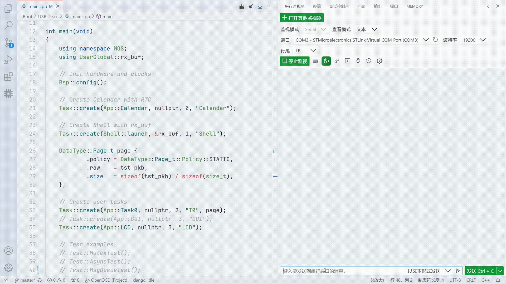
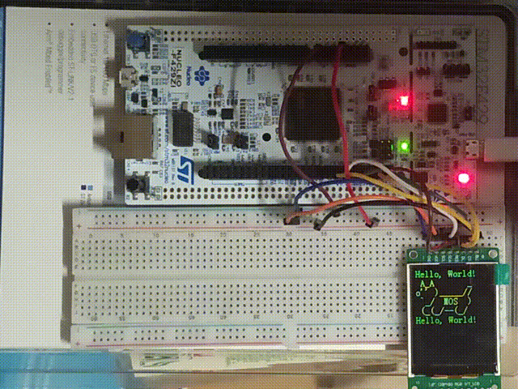

<h1 align="center">

</h1>

<h3 align="center">

<a href="https://github.com/Eplankton/mos-stm32/stargazers"></a>
<a href="https://github.com/Eplankton/mos-stm32/network/members"></a>
<a href="https://github.com/Eplankton/mos-stm32/contributors"></a>
<a href="https://github.com/Eplankton/mos-renode/commits"></a>

**[中文](https://gitee.com/Eplankton/mos-renode) | [English](https://github.com/Eplankton/mos-renode)**

</h3>

> [!NOTE]
> 本项目正在积极开发和改进中，随着设计的不断完善，一些 API 和接口可能会发生变化。

## 简介 🚀

- **MOS** 是一个用 C++/Rust 编写的实时操作系统 (Real-Time Operating System, RTOS) 项目，包含一个抢占式内核和简易命令行，并移植了一些应用层组件（例如 **GuiLite** 和 **FatFS**）。

- [**Renode**](https://renode.io/) 由 [**Antmicro**](https://antmicro.com/) 创建，是一款用于多节点嵌入式网络（有线和无线）的虚拟化平台，旨在实现可扩展的工作流程，开发有效、经过测试且安全的物联网系统。

## 仓库 🌏

- `mos-core` - 内核与简易命令行，**[链接](https://gitee.com/Eplankton/mos-core)**
- `mos-stm32` - 在 STM32 上运行，**[链接](https://gitee.com/Eplankton/mos-stm32)**
- `mos-renode` - 使用 Renode 仿真运行，**[链接](https://gitee.com/Eplankton/mos-renode)**
- `mos-rust` - Vibe Coding 出来的缝合怪，**[链接](https://gitee.com/Eplankton/mos-rust)**

## 快速开始 📦

### 准备

- 安装 **CMake**、**[Arm GNU Toolchain](https://developer.arm.com/downloads/-/arm-gnu-toolchain-downloads)** 和 **[Renode](https://github.com/renode/renode?tab=readme-ov-file#installation)**
- HiFive1 另需 **[xPack RISC-V GCC](https://github.com/xpack-dev-tools/riscv-none-elf-gcc-xpack/releases)**，解压到 `~/.local/xpacks/` 即可被自动找到（或用 `-DMOS_RISCV_TOOLCHAIN_DIR=<dir>/bin` 指定）
- 拉取子模块：`git submodule update --init --recursive`（CMake 也会按需自动初始化）。基准测试用到的子模块（Thread-Metric、RTOS-Benchmark、FreeRTOS-Kernel）默认不拉取，第一次运行基准时自动拉取

### 构建

```bash
./build.sh                  # 菜单选择板卡
./build.sh stm32f4-disco    # 或 stm32h7-disco / hifive1 / all / clean
```

产物位于 `build/<board>/`, `build.sh` 只是对 CMake 的封装：

```bash
cmake -S . -B build/stm32f4-disco -DMOS_BOARD=stm32f4-disco
cmake --build build/stm32f4-disco -j
```

### 仿真

```bash
./emulation/run.sh                       # 菜单选择板卡和模式，自动编译并启动
./emulation/run.sh stm32f4-disco demo    # 也可以直接指定
./emulation/selftest.sh                  # 自测：3 块板 × 6 种调度策略
```

也可以直接用 Renode 打开板卡目录下的脚本：

| 板卡 | 单机 | 双机 M2M |
|---|---|---|
| F4 | `examples/boards/stm32f4-disco/renode/debug.resc` | `.../multi_mach.resc` |
| H7 | `examples/boards/stm32h7-disco/renode/debug.resc` | `.../multi_mach.resc` |
| HiFive1 | `examples/boards/hifive1/renode/debug.resc` | `.../multi_mach.resc` |

单机脚本的 Shell 在 TCP `3333`，GDB 在 `1234`。在 VS Code 中按 `F5`，选择 `Cortex Debug (F4)`、`Cortex Debug (H7)` 或 `RISC-V Debug (HiFive1)` 即可连接。运行模式、端口和各板的模型说明见 [emulation/README.md](emulation/README.md)。

### EIDE

用 VS Code 的 [EIDE](https://github.com/github0null/eide) 插件打开项目根目录，可以构建、烧录 F4 示例（Debug / Release 两个目标）。它的源文件与 `examples/boards/stm32f4-disco/board.cmake` 一致，修改 `BOARD_SOURCES` 时请同步 `.eide/eide.yml`。多平台构建、自测与基准测试以 CMake 为准。

## 性能 📊

在同一台 Renode 仿真机器上（Cortex-M4F 内核，按 100 MIPS 执行指令；SysTick 时钟 16 MHz，系统 tick 1 kHz；计时分辨率 100 ns），用同样的编译选项、计时代码和测试源码对比 MOS 与 **FreeRTOS V11.3.3**。加速比是 MOS 相对 FreeRTOS 的倍数，大于 1 表示 MOS 表现更好。

**Thread-Metric**：吞吐量，次/秒，越高越好

| 测试 | MOS | FreeRTOS | 加速比 |
|---|---:|---:|---:|
| 协作调度 | 1,255,357 | 1,513,615 | 0.83 |
| 抢占调度 | 527,038 | 380,932 | 1.38 ✅|
| 中断处理 | 1,784,401 | 1,218,988 | 1.46 ✅|
| 中断抢占 | 406,205 | 301,985 | 1.35 ✅|
| 消息收发 | 876,547 | 707,410 | 1.24 ✅|
| 同步（信号量） | 2,039,315 | 1,218,996 | 1.67 ✅|

**RTOS-Benchmark**：单次操作延迟，ns，越低越好

| 操作 | MOS | FreeRTOS | 加速比 |
|---|---:|---:|---:|
| 信号量获取（发生切换） | 900 | 4,100 | 4.56 ✅|
| 信号量释放（发生切换） | 1,400 | 2,300 | 1.64 ✅|
| 互斥量加锁（无人持有） | 300 | 800 | 2.67 ✅|
| 互斥量等待（优先级继承） | 1,900 | 5,100 | 2.68 ✅|
| 互斥量移交给等待者（发生切换） | 3,000 | 3,200 | 1.07 ✅|
| 互斥量移交给等待者（不切换） | 1,900 | 1,000 | 0.53 |
| 消息队列发送（发生切换） | 2,500 | 2,900 | 1.16 ✅|
| 消息队列接收（发生切换） | 2,400 | 2,900 | 1.21 ✅|
| Yield（发生切换） | 800 | 700 | 0.88 |

- MOS 在阻塞与唤醒类操作上更快：信号量、互斥量、消息队列，以及相关的吞吐测试（1.2–1.7 倍）。
- FreeRTOS 在单纯的任务切换上更快：yield 约快 1.1 倍，协作调度约快 1.2 倍。
- Renode 不是周期精确的模拟器，这些数字反映的是两个内核代码路径的相对长短，不代表真实硬件上的耗时。
- 复现：`./benchmarks/compare.sh`（约 2 分钟）。完整数据、测试配置和不可比的项目见 [benchmarks/README.md](benchmarks/README.md)。

## 文档 📚

- **[用户手册(中文)](manual_zh.pdf) | [Manual(English) from **DeepWiki**](https://deepwiki.com/Eplankton/mos-renode)**

## 结构 🔍


### 仓库

```text
.
├── core/            // 内核（子模块），见下文
├── examples/
│   ├── common/      // 各板共用的测试与演示
│   └── boards/      // 每块板一个目录
├── emulation/       // Renode 启动与自测脚本
├── benchmarks/      // 基准测试与 FreeRTOS 对比
├── vendor/
│   ├── stm32/       // CMSIS、HAL/LL（子模块）
│   └── sifive/      // 由 SVD 生成的寄存器定义
├── build.sh         // 构建入口
└── CMakeLists.txt
```

各目录的说明：[examples](examples/README.md)（板卡目录约定、如何新增板卡）、[emulation](emulation/README.md)、[benchmarks](benchmarks/README.md)、[vendor/sifive](vendor/sifive/README.md)。

### 内核

```text
core/
├── kernel.hpp          // 内核总头文件
├── shell.hpp           // 命令行
├── config.h            // 配置项
├── CMakeLists.txt      // mos::core 库
│
├── arch/               // 架构移植层
│   ├── cpu.hpp         // 移植接口与编译期检查
│   ├── cpu_isr.hpp     // 异常入口分发
│   ├── cortex_m/       // Cortex-M4/M7
│   └── riscv32/        // RV32 机器模式
│
├── kernel/
│   ├── macro.hpp       // 常量
│   ├── type.hpp        // 基础类型
│   ├── concepts.hpp    // 类型约束
│   ├── data_type/      // 链表、位图、TCB、页面
│   ├── alloc.hpp       // 页面分配
│   ├── global.hpp/.cpp // 全局状态
│   ├── task.hpp        // 任务
│   ├── policy.hpp      // 调度策略
│   ├── scheduler.hpp   // 调度器
│   ├── sync.hpp        // 信号量、互斥量、条件变量
│   ├── ipc.hpp         // 消息队列
│   ├── async.hpp       // 无栈协程
│   └── utils.hpp       // 临界区、日志
│
├── libc/               // printf、newlib 存根
└── external/etl/       // ETL（子模块）
```

## 示例 🍎

每块板有一个可独立编译的例程 `examples/boards/<board>/main.cpp`：

| 板卡 | 内容 |
|---|---|
| F4、H7 | Shell、LED、双机 M2M、内核测试 |
| HiFive1 | Shell、LED、双机 M2M、调度策略测试（不含消息队列与协程压力测试） |

```cpp
// examples/boards/stm32f4-disco/main.cpp
#include "board.hpp"
#include "kernel.hpp"
#include "shell.hpp"
#include "common/kernel_tests.hpp"

using namespace MOS;
namespace Board = Boards::STM32F4Disco;

static void led_task()
{
	while (true) {
		Board::led_toggle();
		Kernel::Task::delay(500_ms);
	}
}

// 具名协程会把参数拷贝进协程帧；带捕获的 lambda 协程只保存闭包引用，闭包是临时对象
static Kernel::Async::Future_t<> m2m_tx(const char* msg)
{
	while (true) {
		Board::hub().send_line(msg);
		co_await Kernel::Async::delay(500_ms);
	}
}

static void m2m_task()
{
	char msg[]           = "Hej! I'm Mx";
	msg[sizeof(msg) - 2] = Board::machine_id();

	m2m_tx(msg);

	while (true) {
		LOG("rx -> \"%s\"", Board::hub().buf.recv().as_str());
	}
}

int main()
{
	Board::init(); // 时钟、GPIO、USART、SysTick

	Kernel::Task::create(Shell::launch<Board::Stdio::max_size()>, &Board::stdio().buf, 0, "shell");
	Kernel::Task::create(led_task, 1, "led");
	Kernel::Task::create(m2m_task, 2, "m2m");

	/* 测试例程 */
	Kernel::Task::create(Test::MsgQueueTest<3>, 2, "msgq/test");
	Kernel::Task::create(Test::AsyncTest<300>, 2, "async/test");

	Kernel::Scheduler::launch(); // 启动调度器，不返回
}
```

板级支持位于 `examples/boards/<board>/board.hpp`（header-only），对例程提供同一组接口：

```cpp
namespace MOS::Boards::STM32F4Disco
{
	using Stdio = Drivers::SyncUart<Drivers::Stm32Usart, MOS_CONF_SHELL_BUF_SIZE>;
	using Hub   = Drivers::SyncUart<Drivers::Stm32Usart, 32>;

	void init();
	Stdio& stdio();
	Hub& hub();
	void led_toggle();
	char machine_id();
}
```

启动后的输出：

```plain
 A_A       _   [name]  @ x.x.x(Version)
o'' )_____//   Build   @ TIME, DATE
 `_/  MOS  )   Chip    @ MCU, ARCH
 (_(_/--(_/    2023-2026 Copyright by Eplankton

<Tid> <Name> <Priority> <Status> <Mem%>
---------------------------------------
 #0   shell        0     RUNNING     7%
 #1   led          1     READY       7%
 #2   m2m          2     READY       7%
 #3   msgq/test    2     READY       7%
 #4   async/test   2     READY       7%
 #5   idle         127   READY      15%
---------------------------------------
```

- `Shell交互`


- `Mutex测试(优先级继承协议)`


- `LCD驱动与GUI`<br>
<p align="center">
  
 
</p>

- `并发任务周期与抢占`<br>
<p align="center">


</p>

## 调度策略 🧭

内核在编译期选择一种调度策略（`Kernel::Policy`），不同策略共享同一套上下文切换代码，无运行时开销：

| 策略 | 就绪队列排序键 | 抢占 | 说明 |
|---|---|---|---|
| `RoundRobin` | 到达顺序 | 时间片 | 忽略优先级，FIFO 轮转 |
| `PreemptPri` | 静态优先级 | 是 | 同优先级内时间片轮转（默认） |
| `RateMonotonic` (RM) | 周期 `T` | 是 | 周期越短优先级越高；`D = T` 时固定优先级最优 |
| `DeadlineMonotonic` (DM) | 相对截止期 `D` | 是 | RM 的推广，适用于 `D <= T` |
| `EarliestDeadlineFirst` (EDF) | 绝对截止期 | 是 | 单核可抢占最优，`ΣC/T <= 1` 即可调度 |
| `Cooperative` (Coop) | 静态优先级 | 否 | 仅在阻塞或主动 `Task::yield()` 时切换 |

在 `core/config.h` 中选择：

```c
#define MOS_CONF_SCHED_POLICY EarliestDeadlineFirst
```

也可以直接通过 CMake 覆盖，无需修改源码：

```bash
cmake -S . -B build/stm32f4-disco -DMOS_SCHED_POLICY=EarliestDeadlineFirst
```

默认仍为 `PreemptPri`，行为与旧版本一致。

### 周期任务

```cpp
static void control_job()
{
	while (true) {
		/* work */
		Kernel::Task::periodic_wait(); // 阻塞到下一次激活
	}
}

Kernel::Task::create_periodic(
    control_job, nullptr,
    0,      // 基础优先级（RM/DM 会按 T/D 覆盖）
    20_ms,  // 周期 T
    20_ms,  // 相对截止期 D（0 表示等于周期）
    "ctrl",
    3_ms    // 可选 WCET，用于准入检查
);
```

- 首个作业在创建时立即激活；此后每次 `periodic_wait()` 唤醒时刷新绝对截止期 `dl_abs = 激活时刻 + D`。
- 提供 WCET 时执行准入检查：RM 使用 Liu & Layland 上界，DM 使用密度测试，EDF 使用 `ΣC/T <= 1`；不通过则返回 `nullptr`。
- 每个作业的截止期丢失只记一次，可通过 `Task::missed_deadlines()` 查询。示例见 `examples/common/sched_demo.hpp`。

### 行为测试

`examples/common/kernel_tests.hpp` 的 `SchedPolicyTest()` 随默认构建自动运行，按策略编译期选择用例，每个用例打印一行 `[TEST] ... PASS/FAIL`：

| 用例 | 适用策略 | 验证内容 |
|---|---|---|
| RR fairness | 全部 | 同优先级（同截止期）任务公平轮转，CPU 份额差异 < 40% |
| Preemption | PreemptPri/RM/DM | 高优先级任务抢占正忙的低优先级任务 |
| Cooperative | Cooperative | 忙碌任务完成前高优先级任务得不到 CPU |
| Deadline order | RM/DM/EDF | 按 T/D/绝对截止期排序运行（逆序创建），RM/DM 校验派生优先级 |
| Periodic timing | PreemptPri/RM/DM/EDF | 激活间隔 ≈ 周期，EDF 下无截止期丢失 |
| Nested PIP | PreemptPri/RM/DM | 嵌套互斥锁的优先级提升逐层回退，中优先级不发生反转 |
| PIP multi-waiter | PreemptPri/RM/DM | 同一互斥量上两个等待者先后提升持有者，解锁后回到基础优先级 |
| PIP unrelated unlock | PreemptPri/RM/DM | 释放一个无人等待的互斥量，不会撤销另一个仍持有的互斥量带来的提升 |
| PIP transitive | PreemptPri/RM/DM | H 等 M、M 等 L 时，L 继承 H 的优先级 |
| MsgQueue recheck | 全部 | 发送者因有空位被唤醒、但空位又被抢走时会重新等待，而不是丢弃消息 |

在 Renode 中运行全部策略与板卡：

```bash
./emulation/selftest.sh                         # 3 块板 x 6 种策略
./emulation/selftest.sh stm32f4-disco --policies PreemptPri,EarliestDeadlineFirst
```

### 说明

- RM/DM 用 `floor(log2(T))` 将周期/截止期映射到优先级 `[0, 31]`，普通任务建议使用 `>= 32` 的优先级。
- EDF 下没有截止期的任务（`Task::create`）排在周期任务之后，并以时间片轮转，不会被饿死。
- `Cooperative` 没有 tick 抢占，CPU 密集型任务必须显式调用 `Task::yield()`。
- 优先级继承（PIP）按互斥量跟踪：支持嵌套加锁、同一互斥量多个等待者以及传递继承（H 等 M、M 等 L 时 L 继承 H），无深度上限。
- 使用 `-DMOS_SCHED_DEMO=ON`（或 `MOS_SCHED_DEMO=ON ./build.sh <board>`）构建策略演示；该构建会跳过 `msgq/test` 与 `async/test` 两个压力测试，以免占满页面池并淹没串口输出。

## 移植 🔌

内核只通过 `MOS::Arch` 中的一组固定接口与 CPU 交互，接口约定写在 [core/arch/cpu.hpp](core/arch/cpu.hpp)，缺任何一项都会在编译期报错：

| 接口 | Cortex-M | RV32（HiFive1） |
|---|---|---|
| `irq_save/irq_restore/irq_enabled` | PRIMASK | `mstatus.MIE` |
| `request_switch()` | 挂起 PendSV | 写 CLINT `msip`（软件中断） |
| `start_first()` | `svc 0` | 从任务帧 `mret` |
| `init_stack()` | 硬件栈帧 + R4–R11 (+EXC_RETURN) | 32 字帧：`mepc`/`ra`/`a0`/`mstatus` |
| 系统 tick | SysTick → `Scheduler::tick()` | CLINT `mtimecmp`（32768 Hz，余数累加保证平均 1 kHz） |
| `idle_wait()` | `wfi` | `wfi` |

每个移植提供两个头文件：`port.hpp`（原语）与 `port_isr.hpp`（异常入口与上下文切换，在 `scheduler.hpp` 末尾引入）。上下文切换汇编与内核之间只约定 `cur_tcb`、`next_tcb()` 和 `MOS_TCB_SP_OFFSET`（TCB 中保存 SP 的偏移，由 `static_assert` 锁定）。

新增一个架构：在 `core/arch/<arch>/` 实现这两个头文件，在 `cpu.hpp`/`cpu_isr.hpp` 中加一个分支，再按 [examples/README.md](examples/README.md) 添加板卡。RV32 移植的说明：

- 所有 trap 共用一个入口，完整整数上下文保存在被中断任务的栈上，随后切到中断栈（复用启动栈）执行 C++ 处理函数；挂起的切换请求在同一次 trap 里完成，不再二次进入。
- 外部中断经 PLIC 分发到板级 `mos_external_irq(source)`。
- 小 RAM 板可在 CMake 中覆盖 `MOS_CONF_POOL_SIZE` 等配置（HiFive1 使用 9 页、12 个任务）。
- 基准测试端口目前仅支持 Cortex-M。

## 里程碑 📜

📦 `v0.5`

> ✅ 完成：
>
> - **调度**
>   - 新增调度策略 `RateMonotonic` / `DeadlineMonotonic` / `EarliestDeadlineFirst` / `Cooperative`，补全 `RoundRobin`
>   - 新增周期任务 API `Task::create_periodic` / `Task::periodic_wait` 与可调度性检查
>   - 缩短调度器切换路径：一次带切换的 yield 从 101 条指令降到 86 条，协作调度吞吐提高 19%
> - **内核修复**
>   - 修复 PendSV 抢占 SysTick 导致的调度停摆、嵌套优先级继承与 tick 回绕比较
>   - 优先级继承改为按互斥量跟踪：修复同一互斥量多个等待者、无关解锁时的错误回退，支持传递继承
>   - `MsgQueue_t` 唤醒后重新检查队列，修复静默丢消息；新增 `IPC::FOREVER`、`send_from_isr/recv_from_isr`
>   - 信号量改为令牌直接移交，`kill`/`resume` 处于等待中的任务不再破坏计数与链表
>   - `CondVar_t::wait` 原子地释放锁并阻塞；ISR 唤醒（`up_from_isr`）在中断返回时立即切换
>   - `IrqGuard_t` 改为保存/恢复 PRIMASK；TCB 取消 packed；idle 无事可做时 `WFI`
> - **移植**
>   - 架构移植层重构为 `MOS::Arch` 接口（`core/arch/cpu.hpp`），内核不再含 Cortex-M 专有代码
>   - 支持 `STM32H747I-DISCO (Cortex-M7)`，与 F4 共用同一套内核
>   - 移植到 `SiFive HiFive1 (FE310, RV32IMAC)`，通过全部调度策略测试，支持 Shell 与双机 M2M；寄存器定义由 SiFive 官方 `design.svd` 生成（`vendor/sifive/`）
> - **工程与测试**
>   - 每块板的例程、驱动、构建与仿真配置集中在 `examples/boards/<board>/`，脚本自动发现板卡；core 提供 `mos::core` CMake 库
>   - STM32 HAL/CMSIS 依赖改为 git submodule 管理
>   - 新增 `emulation/selftest.sh` 自测（3 块板 × 6 种策略）
>   - 新增 Thread-Metric 与 RTOS-Benchmark 基准测试，以及与 FreeRTOS 的对比（`benchmarks/compare.sh`）
> - **[实验性]** 移植到 `ESP32-C6(RISC-V)`
> - **[实验性]** 使用 `Rust` 重写

📦 `v0.4`

> ✅ 完成：
> - 添加 `FPU` 硬件浮点支持
> - 可使用 **CMake Tools** 编译项目
> - 引入嵌入式 C++ 模板库 [**ETL**](https://www.etlcpp.com/)
> - 开发平台迁移，使用 `Renode` 仿真平台, 稳定支持 `Cortex-M` 系列
> - **[实验性]** 添加调度器锁 `Scheduler::suspend()`
> - **[实验性]** 添加异步无栈(Stackless)协程 `Async::{Executor, Future_t, co_await...}`
>
> 📌 计划： 
>
> - 从 `FatFS` 迁移到 `LittleFS`


📦 `v0.3`

> ✅ 完成：
>
> - `Tids` 映射到 `BitMap_t`
> - `IPC::MsgQueue_t`，消息队列
> - `Task::create` 允许泛型函数签名为 `void fn(auto argv)`，提供类型检查
> - 添加 `ESP32-C3` 作为 `WiFi` 元件
> - 添加 `Driver::Device::SD_t`，`SD`卡驱动，移植 `FatFs` 文件系统
> - 添加 `Shell::usr_cmds`，用户注册命令
> - **[实验性]** 原子类型 `<stdatomic.h>`
> - **[实验性]** `Utils::IrqGuard_t`，嵌套中断临界区
> - **[实验性]** `Scheduler + Mutex` 简单的形式化验证
>
> 📌 计划： 
>
> - 进程间通信：管道/通道
> - 性能基准测试
> - `Result<T, E>, Option<T>`，错误处理
> - `DMA_t` 驱动
> - 软/硬件定时器 `Timer`
> - **[实验性]** 添加 `POSIX` 支持
> - **[实验性]** 更多实时调度算法


📦 `v0.2`

> ✅ 完成：
> 
> - `Sync::{Sema_t, Lock_t, Mutex_t<T>, CondVar_t, Barrier_t}` 同步原语
> - `Scheduler::Policy::PreemptPri`，在相同优先级下则以时间片轮转 `RoundRobin` 调度
> - `Task::terminate` 在任务退出时隐式调用，回收资源
> - `Shell::{Command, CmdCall, launch}`，简单的命令行交互
> - `HAL::STM32F4xx::SPI_t` 和 `Driver::Device::ST7735S_t`, 移植 `GuiLite` 图形库
> - `Kernel::Global::os_ticks` 和 `Task::delay`，阻塞延时
> - 重构项目组织为 `{kernel, arch, drivers}`
> - 支持 `GCC` 编译，兼容 `STM32Cube HAL`
> - `HAL::STM32F4xx::RTC_t`, `CmdCall::date_cmd`, `App::Calendar` 实时日历
> - `idle` 使用 `Kernel::Global::zombie_list` 回收非活动页面
> - 三种基本的页面分配策略 `Page_t::Policy::{POOL(池), DYNAMIC(动态), STATIC(静态)}`


📦 `v0.1`

> ✅ 完成：
> 
> - 基本的数据结构、调度器与任务控制、内存管理
>
> 📌 计划： 
> 
> - 定时器，时间片轮转调度
> - 进程间通信 `IPC`，管道、消息队列
> - 进程同步 `Sync`，信号量、互斥锁
> - 移植简单的 `Shell`
> - 可变页面大小，内存分配器
> - `SPI` 驱动，移植 `GuiLite/LVGL` 图形库
> - 移植到其他开发板/架构，例如 `ESP32-C3(RISC-V)`


## 参考资料 🛸
- [How to build a Real-Time Operating System(RTOS)](https://medium.com/@dheeptuck/building-a-real-time-operating-system-rtos-ground-up-a70640c64e93)
- [PeriodicScheduler_Semaphore](https://github.com/Dungyichao/PeriodicScheduler_Semaphore)
- [STM32F4-LCD_ST7735s](https://github.com/Dungyichao/STM32F4-LCD_ST7735s)
- [A printf/sprintf Implementation for Embedded Systems](https://github.com/mpaland/printf)
- [GuiLite](https://github.com/idea4good/GuiLite)
- [STMViewer](https://github.com/klonyyy/STMViewer)
- [FatFs](http://elm-chan.org/fsw/ff)
- [The Zephyr Project](https://www.zephyrproject.org/)
- [Eclipse ThreadX](https://github.com/eclipse-threadx/threadx)
- [Embassy](https://embassy.dev/)
- [Renode](https://renode.io/)
- [Embedded Template Library (ETL)](https://www.etlcpp.com)
---

<p align="center">


</p>

```plain
I hope the Pacific is as blue as it has been in my dreams. 
I hope.

-- Stephen King's "Rita Hayworth and the Shawshank Redemption", 1982
```